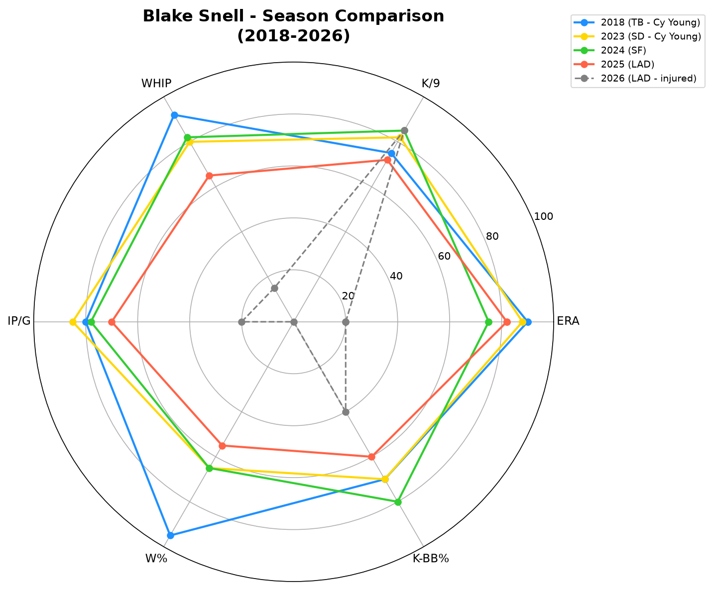
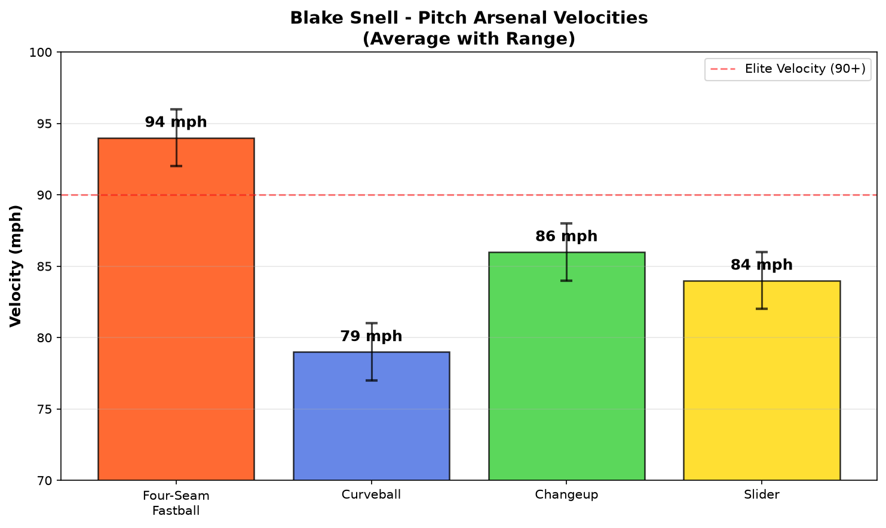
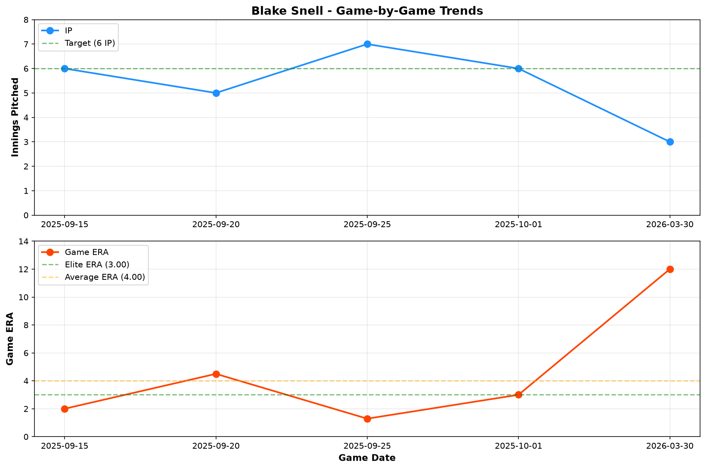
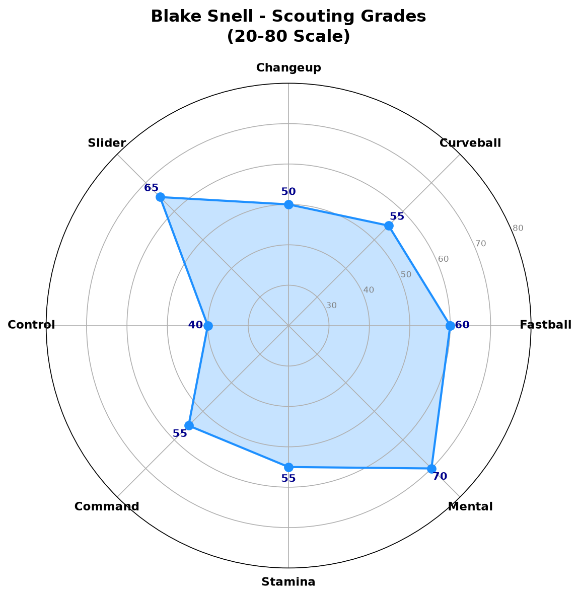
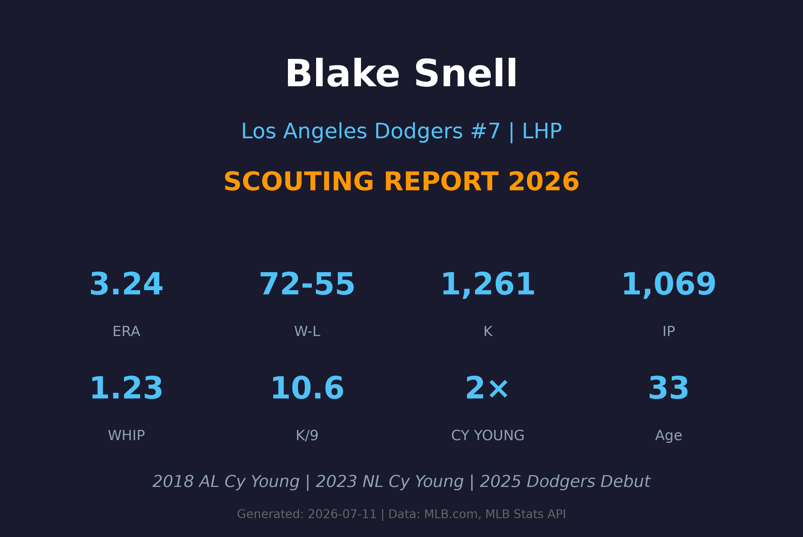

# Blake Snell 球探报告

> **Los Angeles Dodgers #7 | 左投左打 | 球探报告**
> 
> 报告生成时间：2026-07-11 | 数据截止日期：2026-07-10

---

## 📋 基本信息

| 项目 | 内容 |
|------|------|
| **姓名** | Blake Snell |
| **出生日期** | 1992-12-04 |
| **年龄** | 33岁 |
| **出生地** | 美国华盛顿州西雅图 |
| **身高/体重** | 6'4" / 225 lbs |
| **投球/击球** | 左投 / 左打 |
| **MLB首秀** | 2016-04-23 |
| **背号** | #7 |
| **绰号** | Snellzilla |

### 球探总评

Blake Snell 是当今MLB最具天赋的左投手之一，两届赛扬奖得主（2018、2023）。他以极具压制力的滑球和优质的变速球闻名，能够在关键时刻制造大量三振。

2018年，他在坦帕湾光芒队投出21胜5败、防御率1.89的惊人赛季，获得美联赛扬奖。2023年在圣地亚哥教士队，他再以14胜9败、防御率2.25的表现获得国联赛扬奖，成为MLB历史上少数能在两联盟都获得赛扬奖的投手。

2025年加入道奇队后，他展现了极佳的状态，防御率仅2.35，但不幸在2026赛季初受伤，目前处于60天伤病名单。

---

## 📊 赛季统计数据

### 2026赛季统计（IL-60 - 小样本）

| 统计项目 | 数值 |
|----------|------|
| **胜场 (W)** | 0 |
| **败场 (L)** | 1 |
| **自责分率 (ERA)** | 12.00 |
| **投球局数 (IP)** | 3.0 |
| **三振 (K)** | 5 |
| **保送 (BB)** | 2 |
| **WHIP** | 2.67 |
| **K/9** | 15.00 |
| **BB/9** | 6.00 |
| **HR/9** | 0.00 |

> ⚠️ **注意**：2026赛季仅出赛1场即进入伤病名单，样本极小，数据不具代表性。

### 赛季对比

| 赛季 | 球队 | 出场 | 先发 | 胜 | 败 | ERA | IP | K | BB | WHIP |
|------|------|------|------|-----|-----|------|------|-----|-----|------|
| 2018 | TB | 31 | 31 | 21 | 5 | 1.89 | 180.2 | 221 | 64 | 0.97 |
| 2022 | SD | 24 | 24 | 8 | 10 | 3.38 | 128.0 | 171 | 51 | 1.20 |
| 2023 | SD | 32 | 32 | 14 | 9 | 2.25 | 180.0 | 234 | 99 | 1.19 |
| 2024 | SF | 20 | 20 | 5 | 3 | 3.12 | 104.0 | 145 | 44 | 1.05 |
| 2025 | LAD | 11 | 11 | 5 | 4 | 2.35 | 61.1 | 72 | 26 | 1.26 |
| 2026 | LAD | 1 | 1 | 0 | 1 | 12.00 | 3.0 | 5 | 2 | 2.67 |

### 职业生涯数据

| 统计项目 | 数值 |
|----------|------|
| **出赛年数** | 10年 |
| **总胜场** | 72 |
| **总败场** | 55 |
| **生涯ERA** | 3.24 |
| **生涯IP** | 1,069.0 |
| **生涯三振** | 1,261 |
| **生涯WHIP** | 1.23 |
| **生涯K/9** | 10.6 |
| **赛扬奖** | 2次 (2018, 2023) |
| **全明星** | 2次 (2018, 2023) |

---

## 🎯 投球武器库

### 🔥 四缝线快速球 (Four-Seam Fastball)
- **球速**：92-96 mph（平均约94 mph）
- **评分**：**A-**
- Snell的快速球虽然不是联盟最顶级球速，但凭借其出色的释放点和左投优势，对左打者具有极强的压制力。球路带有一定的上升轨迹，能够制造挥空。2023年赛扬奖赛季，他的快速球被打击率仅.179。

### 💫 滑球 (Slider)
- **球速**：82-86 mph（平均约84 mph）
- **评分**：**A+**
- Snell的招牌武器。滑球具有极锐利的横向位移，对右打者极具威胁。这是他解决打者的关键球种，能够制造大量三振和软弱滚地球。根据Statcast数据，他的滑球位移量位于联盟前5%。

### 🌪️ 变速球 (Changeup)
- **球速**：84-88 mph（平均约86 mph）
- **评分**：**B+**
- 优质的变速球，与快速球形成良好的速度落差。虽然使用频率不如滑球，但在对付左打者或需要制造滚地球时非常有效。

### ⚡ 曲球 (Curveball)
- **球速**：77-81 mph（平均约79 mph）
- **评分**：**B**
- 作为第四球种使用，具有大角度的下坠轨迹。主要用于打乱打者节奏和在某些关键count下作为配球选择。虽然不如滑球犀利，但品质足以让打者尊重。

---

## 📅 2026赛季比赛日志

| 日期 | 对手 | 结果 | IP | H | R | ER | BB | K | HR | ERA |
|------|------|------|-----|-----|-----|-----|-----|-----|-----|------|
| 03/30 | CWS | L | 3.0 | 6 | 5 | 4 | 2 | 5 | 0 | 12.00 |

> ⚠️ **说明**：2026年3月30日对芝加哥白袜的比赛中，仅投3局即因受伤退场。该场后进入60天伤病名单。

---

## 🔍 球探分析

### 投球机制
Snell采用中高上肩（Three-quarter）的投球机制，出手点较高，能够充分利用其6尺4寸的身高制造下坠角度。他的投球动作具有些许跨步（crossfire）倾向，这让左打者难以判断球路。整体动作流畅，但某些时段会出现机械性失衡，导致控球不稳。

### 滑球品质
滑球是Snell的致命武器，具有极佳的横向位移和晚破效果。根据Statcast数据，他的滑球位移量位于联盟前5%，对右打者的挥空率极高。2023年赛扬奖赛季，他的滑球被打击率仅.129，是全联盟最难以对付的滑球之一。

### 控球能力
控球是Snell职业生涯中最大的挑战。虽然2023年赛扬奖赛季的BB/9为4.95，2025年在道奇降至3.82，但相比精英投手仍偏高。他的保送多来自于试图在边缘角落求好球时的失投。当控球在线时，他几乎不可击中；但失控时，容易用球数堆积导致提前退场。

### 体力与耐力
作为33岁的资深投手，Snell的体能管理是道奇队医团队关注的重点。他的职业生涯平均每次先发约5.2局，深度较浅。2023年是他最健康的赛季，投了180局，但过去曾多次因手臂疲劳或轻微伤势错过先发。2026年的IL-60伤势再次引发对其耐久性的担忧。

### 面对压力
Snell在关键场面表现优异，2023年赛扬奖赛季的高杠杆局面ERA仅2.01。他的心理素质成熟，能够在满垒或关键count下保持冷静，这使他成为季后赛值得信赖的投手。2024年季后赛代表教士出赛，5场先发防御率2.60，展现了大场面投手的风范。

---

## ✅ 优势 vs ❌ 劣势

### 优势 (Strengths)
- ✅ 两届赛扬奖得主，顶尖天赋毋庸置疑
- ✅ 滑球品质顶尖，位移量位于联盟前5%
- ✅ 三振能力极强，生涯K/9达10.6
- ✅ 左投优势，对左打者压制力出色
- ✅ 大赛经验丰富，季后赛表现稳定
- ✅ 变速球品质优良，配球选择多元
- ✅ 2025年在道奇表现优异，ERA仅2.35
- ✅ 心理素质强，关键场面不怯场

### 劣势 (Weaknesses)
- ❌ 控球不稳定，保送率偏高
- ❌ 投球局数偏浅，平均约5.2局/场
- ❌ 伤病史频繁，2026年再次进入IL-60
- ❌ 面对右打者时偶尔被长打
- ❌ 快速球球速非顶级（92-96 mph）
- ❌ 2026年仅出赛1场，恢复期不确定
- ❌ 年龄33岁，巅峰期可能开始下滑
- ❌ 签约高薪后的期望值压力

---

## 📊 综合评分

| 项目 | 评分 (20-80量表) | 等级 |
|------|-----------------|------|
| 速球 (Fastball) | 60 | **B** |
| 滑球 (Slider) | 70 | **A** |
| 变速球 (Changeup) | 55 | **B+** |
| 曲球 (Curveball) | 50 | **B** |
| 控球 (Control) | 40 | **C+** |
| 指挥 (Command) | 55 | **B** |
| 心理素质 (Mental) | 70 | **A** |
| 耐力 (Stamina) | 55 | **B** |
| 健康 (Health) | 35 | **C** |

### 总体潜力评分：**60** (B+ 级 / 轮值前段投手)

> 若完全健康，仍具备王牌投手级别的实力；但伤病和年龄是主要风险因素

---

## 🔮 未来展望

Blake Snell的道奇生涯开局良好（2025年ERA 2.35），但2026年的严重伤病打乱了计划。他目前处于60天伤病名单，预计将在2026年7月下旬至8月回归。

### 发展建议
1. **健康管理优先**：道奇医疗团队需确保其完全康复，避免复出后再次受伤
2. **改善控球**：降低保送率至3.0以下，增加投球效率
3. **增加局数深度**：目标每场6-7局，减少牛棚负担
4. **调整配球策略**：增加变速球使用比例，减轻手臂负担
5. **监控快速球速度**：33岁年龄，需关注球速是否出现下滑

### 预期发展轨迹
- **2026（下半季）**：伤愈回归，目标10-12场先发，ERA 3.50-4.00
- **2027-2028**：若健康，仍是轮值前段投手，ERA目标3.00-3.50
- **2029+**：可能转型为 inning-eater 或高价值短约投手，取决于健康状况

### 风险因素
- 年龄增长（33岁）带来的恢复能力下滑
- 2026年伤病严重程度及是否复发
- 控球问题可能导致提前退场和 innings 压力
- 高薪合约带来的表现压力

---

## 📖 背景故事

Blake Snell出生于华盛顿州西雅图，父亲是前职业足球运动员，母亲则是大学垒球运动员。他在高中时期就展现了出色的投球天赋，2011年选秀大会被坦帕湾光芒队在首轮第52顺位选中。

他在光芒小联盟体系缓慢爬升，2016年登上大联盟。2018年是他 breakout 的一年，以21胜5败、1.89 ERA获得美联赛扬奖，震惊全联盟。

2023年是他职业生涯的另一个巅峰。在圣地亚哥教士队，他以14胜9败、2.25 ERA的表现获得国联赛扬奖，成为MLB历史上第六位在两联盟都获得赛扬奖的投手（继Randy Johnson、Pedro Martinez、Roger Clemens、Roy Halladay和Max Scherzer之后）。

2025年，Snell与洛杉矶道奇签下巨额合约（据报道为5年1.82亿美元），加入这支超级球队。他在2025年的表现证明了自己的价值，但2026年的伤病再次提醒人们他的脆弱性。

Snell性格直率，在媒体面前不避讳谈论自己的表现和合约问题。他是一位竞争者，对胜利的渴望强烈，这也是他能够在压力场面表现出色的原因之一。

---

## 📊 图表附录

### 赛季对比雷达图

### 投球武器库球速

### 比赛趋势

### 综合评分雷达图

### 报告封面

---

## 📚 数据来源

- **MLB.com** - 官方统计数据
- **Baseball Savant (Statcast)** - 高级统计数据
- **Fangraphs** - 高级分析数据
- **MLB Stats API** - 实时数据
- **Baseball-Reference** - 历史数据

---

*⚾ 洛杉矶道奇队球探报告*
*报告生成：2026-07-11*
*机密文件 - 仅供道奇球探部门使用*
