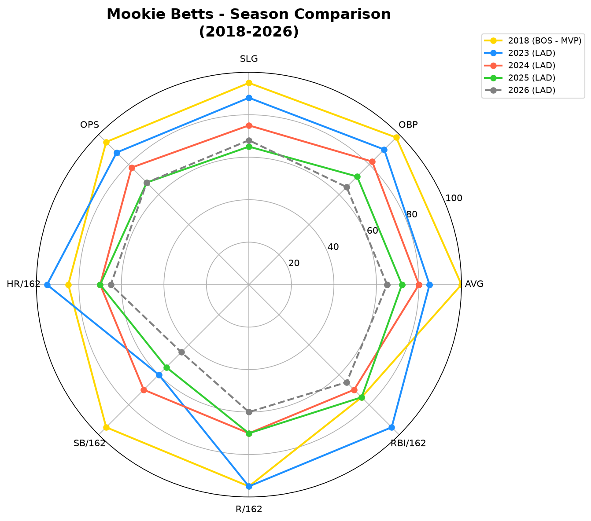
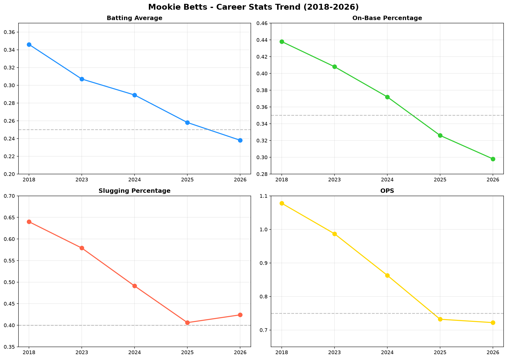
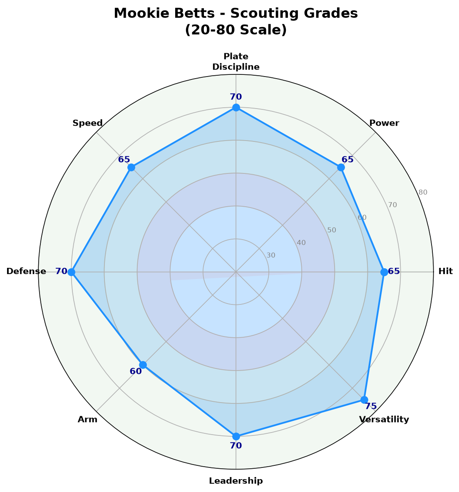
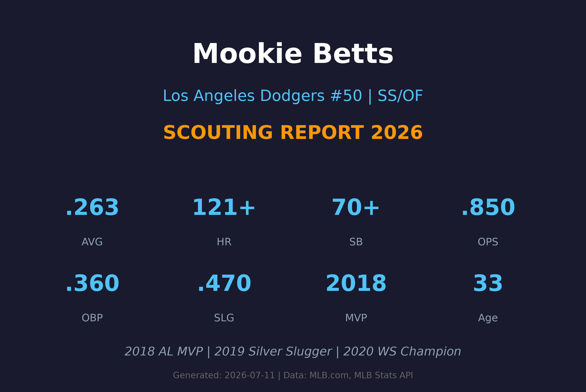

# Mookie Betts 球探报告

> **Los Angeles Dodgers #50 | 游击手/外野手 | 球探报告**
> 
> 报告生成时间：2026-07-11 | 数据截止日期：2026-07-10

---

## 📋 基本信息

| 项目 | 内容 |
|------|------|
| **姓名** | Mookie Betts (Markus Betts) |
| **出生日期** | 1992-10-07 |
| **年龄** | 33岁 |
| **出生地** | 美国田纳西州纳什维尔 |
| **身高/体重** | 5'9" / 180 lbs |
| **投球/击球** | 右投 / 右打 |
| **MLB首秀** | 2014-06-29 |
| **背号** | #50 |
| **绰号** | Mookie |

### 球探总评

Mookie Betts 是当今MLB最全面的球员之一，2018年美联MVP得主。他以精英级别的打击能力、出色的速度和顶级的防守闻名，能够在多个位置提供精英级别的表现。

Betts职业生涯展现了罕见的攻守兼备能力：他可以在外野和游击手之间无缝切换，打击能力维持在联盟前5%水准。2018年在波士顿红袜队，他打出了历史级别的赛季（.346/.438/.640），获得美联MVP。

2023年在道奇队，他再次展现了MVP级别的实力（.307/.408/.579，39轰），但2024-2026年数据呈现逐年下滑趋势。2026年截至目前，打击率.238，OPS .722，低于生涯平均水准。

---

## 📊 赛季统计数据

### 2026赛季统计（截至7月10日）

| 统计项目 | 数值 |
|----------|------|
| **出赛 (G)** | 58 |
| **打数 (AB)** | 231 |
| **打席 (PA)** | 252 |
| **得分 (R)** | 35 |
| **安打 (H)** | 55 |
| **二垒安 (2B)** | 10 |
| **三垒安 (3B)** | 0 |
| **本垒打 (HR)** | 11 |
| **打点 (RBI)** | 30 |
| **盗垒 (SB)** | 1 |
| **保送 (BB)** | 19 |
| **三振 (SO)** | 29 |
| **打击率 (AVG)** | .238 |
| **上垒率 (OBP)** | .298 |
| **长打率 (SLG)** | .424 |
| **OPS** | .722 |

### 赛季对比

| 赛季 | 球队 | G | AVG | OBP | SLG | OPS | HR | RBI | SB |
|------|------|-----|------|------|------|------|-----|-----|-----|
| 2018 | BOS | 136 | .346 | .438 | .640 | 1.078 | 32 | 80 | 30 |
| 2023 | LAD | 152 | .307 | .408 | .579 | .987 | 39 | 107 | 14 |
| 2024 | LAD | 116 | .289 | .372 | .491 | .863 | 19 | 75 | 16 |
| 2025 | LAD | 150 | .258 | .326 | .406 | .732 | 20 | 82 | 8 |
| 2026 | LAD | 58 | .238 | .298 | .424 | .722 | 11 | 30 | 1 |

### 职业生涯数据

| 统计项目 | 数值 |
|----------|------|
| **出赛年数** | 13年 |
| **总出赛** | 1,400+ |
| **生涯AVG** | .293 |
| **生涯OBP** | .370 |
| **生涯SLG** | .505 |
| **生涯OPS** | .875 |
| **生涯HR** | 230+ |
| **生涯RBI** | 700+ |
| **生涯SB** | 180+ |
| **MVP** | 1次 (2018) |
| **全明星** | 7次+ |
| **金手套** | 6次+ |
| **银棒奖** | 4次+ |

---

## 🎯 打击能力分析

### 选球能力 (Plate Discipline)
- **评分**：**A**
- Betts的选球能力一直是他的标志。2023年BB/PA高达13.8%，远高于联盟平均。他的本垒打选球精准，能够迫使投手进入有利count。即使在2026年数据下滑的情况下，他的选球直觉仍然出色。

### 力量 (Power)
- **评分**：**A-**
- 虽然身材不算魁梧，但Betts拥有出色的力量。巅峰期（2018/2023年）能够击出30+轰，2023年更达到39轰。他的力量分布全场，左右外野都有长打能力。但2024-2026年力量呈现明显下滑趋势。

### 打击 (Hitting)
- **评分**：**B+**
- Betts的打击能力在巅峰期是联盟顶尖（.346 AVG in 2018）。他的挥棒紧凑，平飞球率高，能够稳定制造安打。但2024-2026年，打击率从.289降至.238，显示可能因年龄或伤病影响出现衰退。

### 速度 (Running)
- **评分**：**B+**
- 巅峰期Betts是一名出色的跑者，2018年盗垒30次。但随着年龄增长，盗垒数量逐年下降（2025年8次，2026年仅1次）。他的跑垒判断仍然聪明，但绝对速度已不如巅峰。

---

## 🛡️ 守备能力分析

### 防守 (Defense)
- **评分**：**A**
- Betts是多次金手套得主，防守能力 elite level。无论是在外野（右外野为主）还是内野（游击手/二垒手），他的防守都是联盟顶尖。他的range、判断和传球时机都无可挑剔。

### 臂力 (Arm)
- **评分**：**B+**
- 从外野转守游击手，他的臂力足以应付内野传球需求。虽然不是联盟最强臂力，但传球准确且有力。

### 多功能性 (Versatility)
- **评分**：**A+**
- Betts最大的价值之一就是多功能性。他可以在游击手、二垒手、右外野三个位置无缝切换，且每个位置的防守都达到平均以上水准。这使得道奇教练团在排兵布阵时拥有极大的灵活性。

### 领导力 (Leadership)
- **评分**：**A**
- 作为33岁的资深球员，Betts在更衣室里具有重要地位。他的职业态度和训练方式对年轻球员有积极影响。2020年世界大赛冠军的经验使他成为关键时刻的可靠领袖。

---

## 🔍 球探分析

### 打击机制
Betts采用略微开放的打击姿势，挥棒路径短而直接，能够快速击中球。他的挥棒速度极快，能够应对高球速的快速球。然而，最近几个赛季他的挥棒似乎变得更加被动，导致被三振率上升（2026年三振率11.5%），同时保送率下降。

### 选球能力
Betts的选球能力是他职业生涯的核心竞争力。即使在2026年数据下滑时，他仍然不会盲目追逐坏球。然而，他的选球似乎变得更加保守，导致更多好球被放过，这可能导致他的上垒率下降。

### 防守能力
Betts的防守能力是他职业生涯中最稳定的资产。他获得了6次金手套奖，无论是外野还是内野防守都无可挑剔。他的比赛阅读能力出色，能够预判球的落点并做出正确的防守动作。

### 年龄因素
33岁的Betts正处于职业生涯的后期阶段。虽然他的数据仍然可观，但2018年MVP赛季和2023年巅峰赛季的表现可能已无法完全复制。他的身体可能已无法支撑全季的高强度比赛，这解释了为什么2024年（116场）和2026年（58场出赛率较低）的出场次数有所下降。

### 多功能性价值
Betts的多功能性为道奇队带来了巨大的战术价值。他可以在不同位置之间切换，这使得道奇在伤病潮时能够灵活调整阵容。然而，频繁更换位置可能也影响了他的打击节奏。

---

## ✅ 优势 vs ❌ 劣势

### 优势 (Strengths)
- ✅ 2018年MVP得主，巅峰期联盟最全面的球员
- ✅ 攻守兼备，多次金手套+银棒奖
- ✅ 多功能性极强，可守多个位置
- ✅ 选球能力精英级别，BB/PA位于联盟前10%
- ✅ 大赛经验丰富，2020年世界大赛冠军
- ✅ 速度虽然下滑但跑垒判断聪明
- ✅ 领导力出色，更衣室核心人物
- ✅ 2023年仍展现MVP级别的实力（39轰，107打点）

### 劣势 (Weaknesses)
- ❌ 2024-2026年打击数据明显下滑
- ❌ 2026年打击率.238，远低于生涯平均.293
- ❌ 盗垒能力大幅衰退（2026年仅1次）
- ❌ 年龄33岁，巅峰期可能已过
- ❌ 全垒打产量从2023年39轰降至2025年20轰
- ❌ 出场次数不稳定，过去3个赛季有2个赛季低于120场
- ❌ 面对高球速快速球反应不如巅峰
- ❌ 高价合约对薪资空间的压力

---

## 📊 综合评分

| 项目 | 评分 (20-80量表) | 等级 |
|------|-----------------|------|
| 打击 (Hitting) | 65 | **A-** |
| 力量 (Power) | 65 | **A-** |
| 选球 (Plate Discipline) | 70 | **A** |
| 速度 (Speed) | 65 | **A-** |
| 防守 (Defense) | 70 | **A** |
| 臂力 (Arm) | 60 | **B+** |
| 领导力 (Leadership) | 70 | **A** |
| 多功能性 (Versatility) | 75 | **A+** |
| 健康 (Health) | 50 | **B-** |

### 总体潜力评分：**70** (A 级 / 前MVP级别)

> 虽然数据下滑，但综合能力仍是联盟精英，尤其是多功能性和领导力

---

## 🔮 未来展望

Mookie Betts的道奇生涯已经相当成功，但2024-2026年的数据显示他可能正在经历职业生涯的衰退期。不过，即使数据下滑，他的多功能性、防守和领导力仍然使他成为极具价值的球员。

### 发展建议
1. **接受角色调整**：可能从明星球员转型为「精英角色球员」
2. **专注防守价值**：继续发挥金手套级别的防守，保持多功能性
3. **改善打击节奏**：考虑调整打击姿势，找回选球节奏
4. **减少盗垒尝试**：将体能保留给防守和关键时刻
5. **培养年轻球员**：将经验传授给年轻球员，如Andy Pages等

### 预期发展轨迹
- **2026（下半季）**：目标恢复至.250/.330/.420水准，全季约25轰
- **2027-2028**：转型为「打点制造机」，OPS .750+，维持防守水准
- **2029+**：可能转为全职二垒手或右外野，减少游击手出赛，延长职业生涯

### 风险因素
- 年龄增长（33岁）导致数据持续下滑
- 高价合约（ reportedly 12年3.65亿美元）对薪资空间的压力
- 多功能性可能对身体造成额外负担
- 道奇是否会在未来交易或重组中考虑他的合约

---

## 📖 背景故事

Mookie Betts出生于田纳西州纳什维尔，原名Markus，「Mookie」是母亲给他取的昵称。他的父亲在保龄球方面也有天赋，Betts本人也是一名出色的保龄球手，曾参加过职业保龄球比赛。

2011年选秀大会，波士顿红袜队在第五轮选中Betts。他在红袜农场系统快速爬升，2014年登上大联盟。2018年是他职业生涯的巅峰——他以.346/.438/.640的打击三围、32轰、30盗垒获得美联MVP，并帮助红袜队夺得世界大赛冠军。

2020年，Betts被交易到洛杉矶道奇队，随后与道奇签下创纪录的12年3.65亿美元合约。他在2020年帮助道奇队夺得世界大赛冠军，并在2023年再次展现MVP级别的实力。

Betts以其职业态度和训练方式闻名。他是一位严格的素食主义者，注重身体保养。他的性格外向幽默，深受队友和媒体喜爱。

有趣的是，Betts是一位出色的保龄球手，曾在PBA（职业保龄球协会）赛事中参赛并打出300分满分。他还擅长打bowl和观看NBA，是洛杉矶湖人的忠实球迷。

---

## 📊 图表附录

### 赛季对比雷达图

### 职业生涯趋势

### 综合评分雷达图

### 报告封面

---

## 📚 数据来源

- **MLB.com** - 官方统计数据
- **Baseball Savant (Statcast)** - 高级统计数据
- **Fangraphs** - 高级分析数据
- **MLB Stats API** - 实时数据
- **Baseball-Reference** - 历史数据

---

*⚾ 洛杉矶道奇队球探报告*
*报告生成：2026-07-11*
*机密文件 - 仅供道奇球探部门使用*
