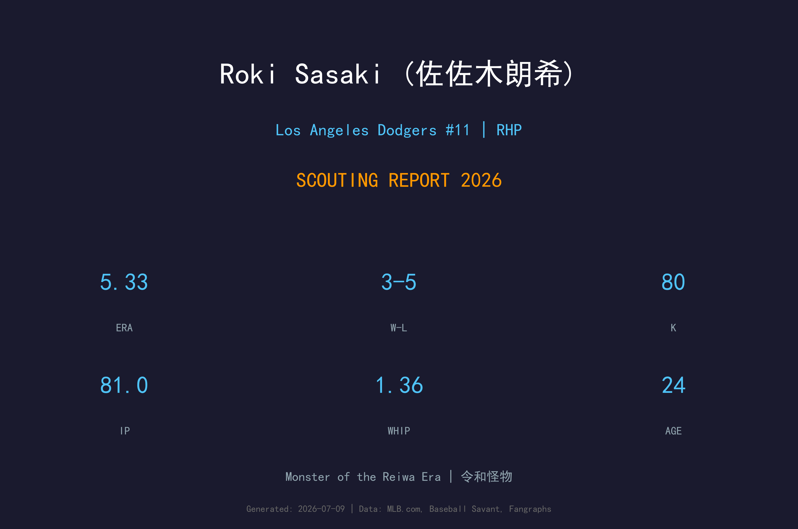
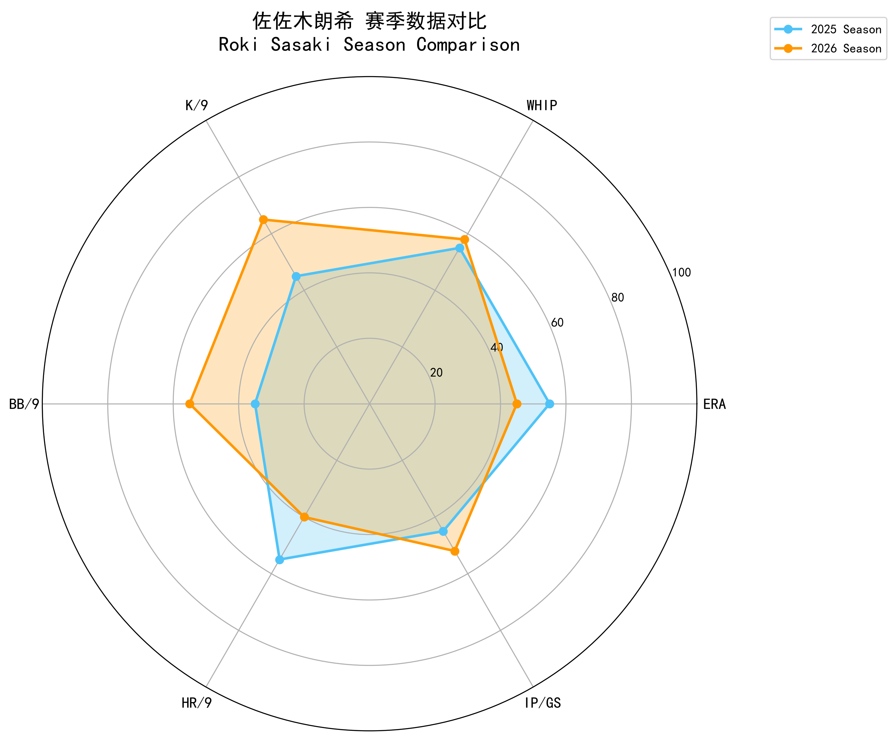
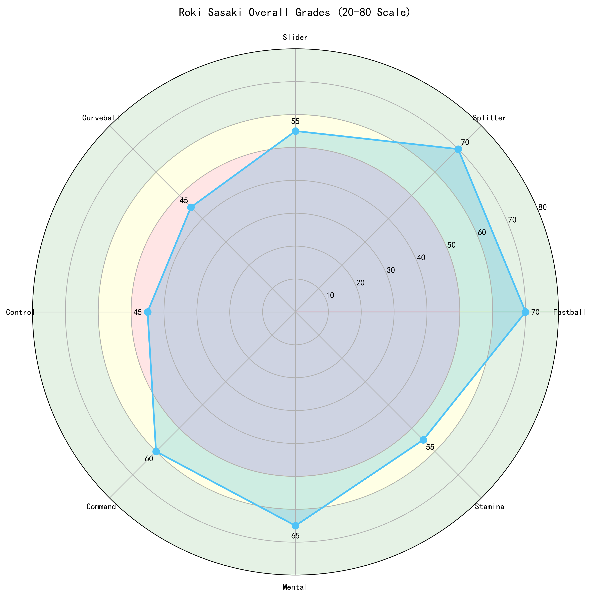
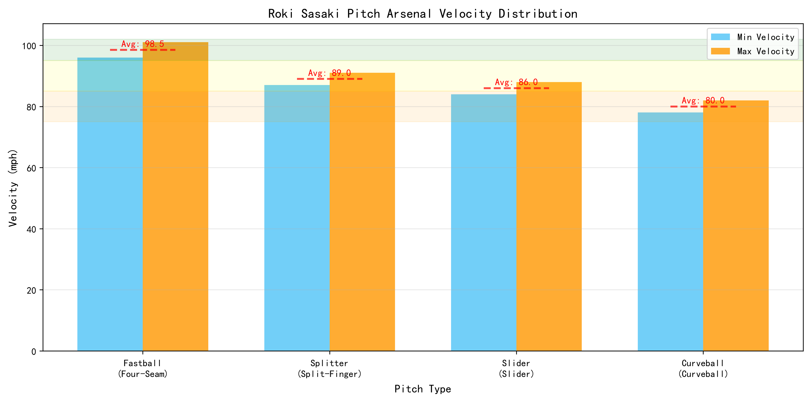
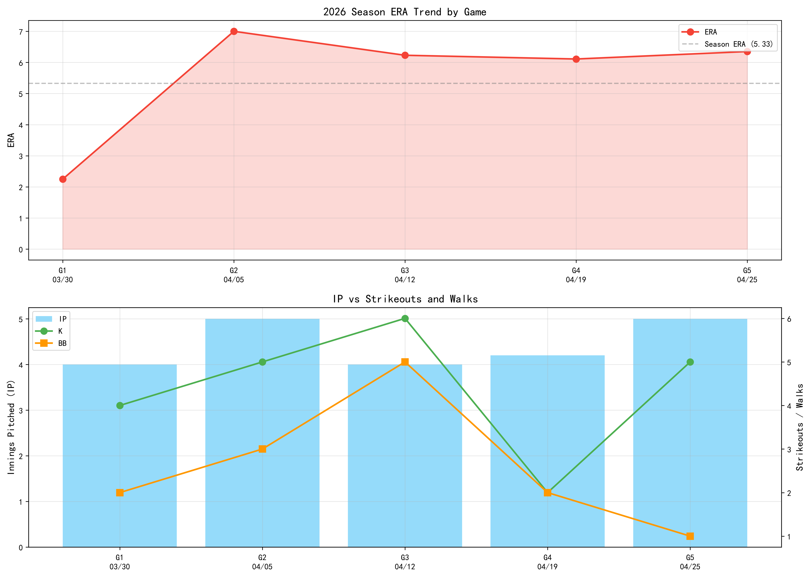

# 佐佐木朗希 (Roki Sasaki) 球探报告

> **Los Angeles Dodgers #11 | 先发投手 | 右投/右打 | 令和怪物 (Monster of the Reiwa Era)**
> 
> 报告生成时间：2026-08-21 | 数据截止日期：2026-08-20

---

## 📋 基本信息

| 项目 | 内容 |
|------|------|
| **姓名** | 佐佐木朗希 (Roki Sasaki) |
| **出生日期** | 2001-11-03 |
| **年龄** | 24岁 |
| **出生地** | 日本岩手县陆前高田市 |
| **身高/体重** | 6'2" / 187 lbs |
| **投球/击球** | 右投 / 右打 |
| **MLB首秀** | 2025-03-19 |
| **背号** | #11 |
| **绰号** | 令和怪物 (Monster of the Reiwa Era) |

### 球探总评

佐佐木朗希是日本棒球界近年来最具天赋的投手之一，被誉为'令和时代的怪物'。他以惊人的速球和犀利的指叉球闻名，高中时期就曾投出时速101英里的快速球。2022年4月10日，他在日本职棒投出了完全比赛，单场19次三振、连续13次三振均创下纪录。2025年加入洛杉矶道奇后，经历了适应期。进入2026赛季，他已从轮值边缘人成长为稳定的先发投手：截至8月20日，22场先发5胜5负、ERA 4.42、116.0局、114次三振，K/9从2025年的6.94提升至8.84，BB/9从5.45大幅降至3.57，WHIP从1.43降至1.30。虽然仍偶有大比分失分，但整体趋势明显向上，已具备大联盟轮值中坚投手的雏形。

---

## 📊 2026赛季统计数据

| 统计项目 | 数值 |
|----------|------|
| **出赛 (G)** | 22 |
| **先发 (GS)** | 22 |
| **胜场 (W)** | 5 |
| **败场 (L)** | 5 |
| **自责分率 (ERA)** | 4.42 |
| **投球局数 (IP)** | 116.0 |
| **被安打 (H)** | 105 |
| **自责分 (ER)** | 57 |
| **全垒打 (HR)** | 21 |
| **三振 (SO)** | 114 |
| **保送 (BB)** | 46 |
| **WHIP** | 1.30 |
| **K/9** | 8.84 |
| **BB/9** | 3.57 |

> ⚠️ **注意**：2026年数据截至8月20日。佐佐木本赛季局数与三振能力较2025年均有显著提升，但偶有大比分失分与被全垒打问题仍需改善。

---

## 📊 赛季对比

| 赛季 | 球队 | 出赛 | 先发 | 胜 | 败 | ERA | IP | 三振 | 保送 | WHIP | K/9 | BB/9 |
|------|------|------|------|-----|-----|------|------|------|------|------|------|------|
| 2025 | Los Angeles Dodgers | 10 | 8 | 1 | 1 | 4.46 | 36.1 | 28 | 22 | 1.43 | 6.94 | 5.45 |
| 2026 | Los Angeles Dodgers | 22 | 22 | 5 | 5 | 4.42 | 116.0 | 114 | 46 | 1.30 | 8.84 | 3.57 |

---

## 🏆 职业生涯数据

| 统计项目 | 数值 |
|----------|------|
| **MLB年资** | 2年 |
| **总出赛** | 32 |
| **生涯ERA** | 约4.44 |
| **生涯IP** | 152.1 |
| **生涯三振** | 142 |
| **生涯WHIP** | 1.34 |
| **主要荣誉** | NPB 完全比赛 (2022), 日美顶级新秀 |

---

## 🎯 投球武器库

### 🔥 四缝线快速球 (Four-Seam Fastball)
- **球速**：96-101 mph
- **使用占比**：约50%
- **评分**：**A+**
- 佐佐木的招牌球种，高中时期就达到101mph。平均球速约98mph，上旋强烈，具有极佳的上升轨迹，能够制造大量挥空。2026年三振能力回升，速球品质仍是 elite 级别。

### 💫 指叉球 (Split-Finger)
- **球速**：87-91 mph
- **使用占比**：约30%
- **评分**：**A+**
- 极具破坏力的变化球，下落幅度大，速度落差明显。是佐佐木解决打者的关键武器，对左右打者都能制造挥空。

### 🌪️ 滑球 (Slider)
- **球速**：84-88 mph
- **使用占比**：约15%
- **评分**：**B**
- 横向位移明显的滑球，对右打者极具威胁。与快速球搭配使用时效果显著，但仍需提升对左打者的压制力。

### ⚡ 曲球 (Curveball)
- **球速**：78-82 mph
- **使用占比**：约5%
- **评分**：**C+**
- 偶尔使用的变化球，主要用于打乱打者节奏。仍在开发中，若能提升稳定性，将成为重要的第四球种。

---

## 🔍 球探分析

### 投球机制
佐佐木采用高上肩（Over-the-top）的投球机制，出手点高，能够充分运用身高优势制造下坠角度。投球动作流畅，身体协调性出色，虽然投球动作中有些许复杂度，但整体重复性良好。

### 速球品质
四缝线快速球是他的致命武器，平均球速约98mph，最高可达101mph以上。球的旋转效率极高，产生强烈的上升效应，使得打者常常挥空或击出高飞球。2026年他的三振能力明显回升，速球仍是主要压制手段。

### 控球进步
控球是佐佐木过去最大的挑战，但2026年已有显著改善。BB/9从2025年的5.45降至3.57，保送率大幅下降。随着信心提升，他在好球带边缘的command越来越稳定，早期 inning 的控球问题减少。

### 体力与耐力
作为年轻投手，佐佐木的体能管理仍在开发中，但已有明显进步。2026年每季投球局数从36.1局大幅提升至116局，显示球队对他的信任和身体的成长。若能持续健康，他有望在赛季末接近180局。

### 被长打问题
目前主要隐患是被全垒打率偏高（2026年21轰/116局，HR/9约1.63）。这反映他偶尔会把速球留在红中，或变化球失投。改善策略执行和球路混合是下一步关键。

---

## ✅ 优势 vs ❌ 劣势

### 优势 (Strengths)
- ✅ 顶级速球，最高可达101mph+
- ✅ 指叉球极具破坏力，三振利器
- ✅ 2026年控球大幅进步，BB/9从5.45降至3.57
- ✅ 三振能力回升，K/9从6.94提升至8.84
- ✅ 投球动作流畅，身体协调性好
- ✅ 心理素质强，大场面不怯场
- ✅ 年轻，潜力巨大，只有24岁
- ✅ 已成长为稳定轮值成员，局数大幅增加
- ✅ 日本职棒完全比赛经验

### 劣势 (Weaknesses)
- ❌ 被全垒打率仍偏高（HR/9约1.63）
- ❌ 变化球控制不够稳定，偶尔会失投
- ❌ 面对左打者表现略差
- ❌ 仍偶有大比分失分场次
- ❌ MLB经验相对较少，仍在学习联盟打者
- ❌ 曲球/变速球作为第四球种尚未成熟

---

## 📊 综合评分

| 项目 | 评分 (20-80) | 等级 |
|------|-------------|------|
| 速球 | 75 | A+ |
| 指叉球 | 75 | A+ |
| 滑球 | 55 | B |
| 曲球 | 45 | C+ |
| 控球 | 50 | B- |
| 指挥 | 60 | B |
| 心理素质 | 65 | A- |
| 耐力 | 60 | B- |

### 总体评分：60 (B+ 级 / 未来轮值核心)

---

## 🔮 未来展望

佐佐木朗希无疑是道奇队未来轮值的重要一环。2026年的进步证明他正在适应大联盟：控球改善、三振回升、局数增加。只要保持健康并继续降低保送与全垒打，他有望在未来2-3年内成为球队的王牌投手。

### 发展建议
1. **继续改善控球：** 将BB/9进一步压至3.0以下，提升早期 inning 效率。
2. **减少被全垒打：** 改善速球位置，避免把球留在红中。
3. **面对左打者：** 加强对左打者的应对策略，增加变化球和指叉球的使用。
4. **提升耐力：** 目标2026年突破160局，2027年挑战180局。
5. **开发第四球种：** 让曲球或变速球成为稳定的配球工具。

### 预期发展轨迹
- **2026-2027：** 稳定轮值成员，ERA目标3.80-4.30，每季160+局
- **2028-2029：** 轮值前段投手，ERA目标3.20-3.70，入选全明星
- **2030+：** 王牌投手候选人，赛扬奖竞争者

---

## 📖 背景故事

佐佐木朗希的名字源自日本特摄剧《百兽战队牙吠连者》中的反派角色'六鬼'（Rokui）。他有两个兄弟，分别是龙树（Ryuki）和怜树（Reiki）。

2011年3月11日，年仅9岁的佐佐木正在陆前高田市立高田小学读三年级。那天，日本发生了里氏9.1级的大地震，随后引发了巨大的海啸。佐佐木在这场灾难中失去了父亲和祖父母。陆前高田市超过1,750名市民在这场灾难中遇难或失踪。

这段经历深深影响了佐佐木。在2025年加盟道奇队的记者会上（当时正值洛杉矶山火肆虐），他说道：'我也曾经历过灾难，遭受过很多痛苦，但我努力不要忘记始终向前看。'

佐佐木在高中时期就被称为'令和时代的怪物'，这个绰号是对前辈松坂大辅（被称为'平成时代的怪物'）的致敬。高中时他的快速球就达到了101mph。

2022年4月10日，他在日本职棒投出了完全比赛，成为日本职棒史上第16位达成此成就的投手，也是自1994年牧原成以来首位。那场比赛他三振19人，包括连续13次三振，创下了日本职棒纪录。

加盟道奇队后，队友米格尔·罗哈斯（Miguel Rojas）将自己的11号球衣让给了他。作为感谢，佐佐木送给罗哈斯三瓶清酒和一套酒具。

---

## 📈 图表附录

- 报告封面：
- 赛季对比：
- 综合评分雷达图：
- 球速分布：
- 比赛趋势：

---

*数据来源：MLB.com | Baseball Savant | MLB Stats API*
*报告生成：2026-08-21*
