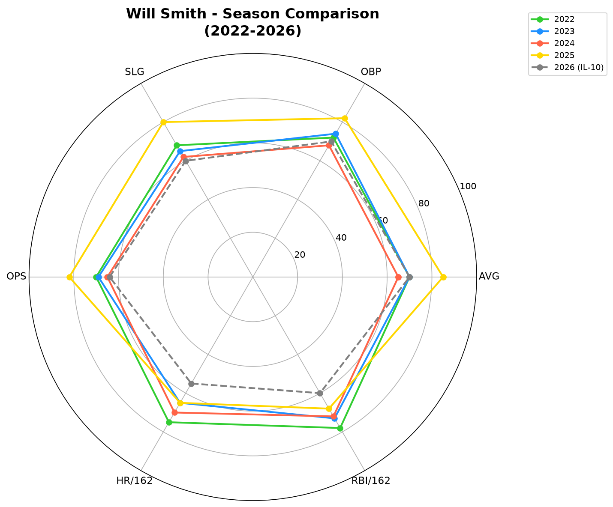
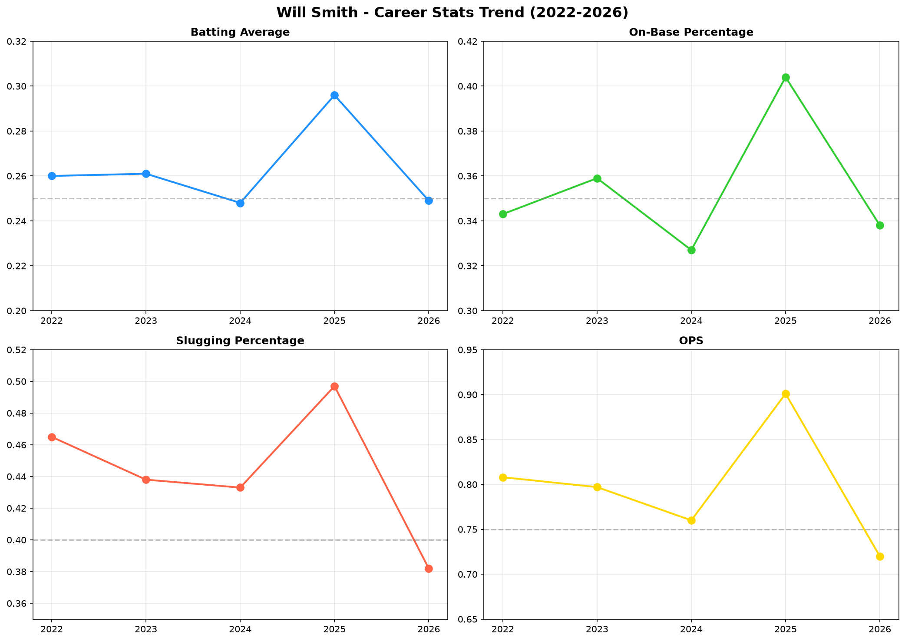
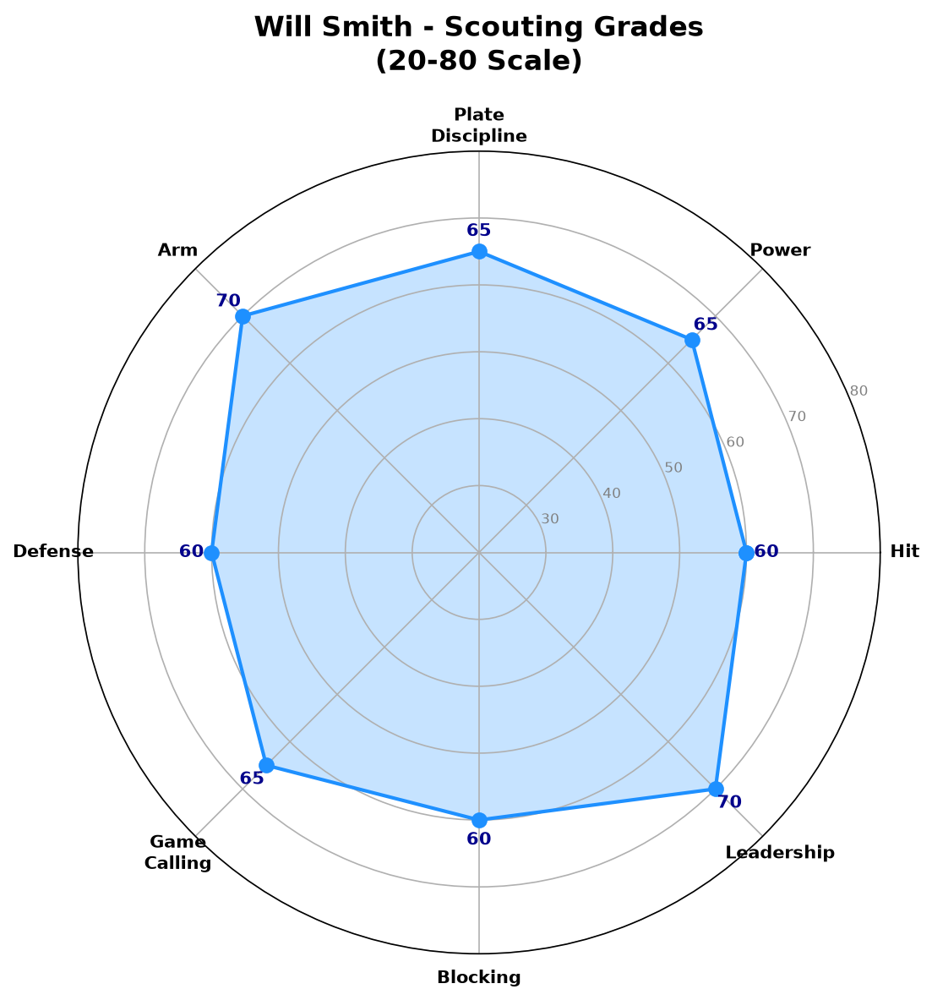
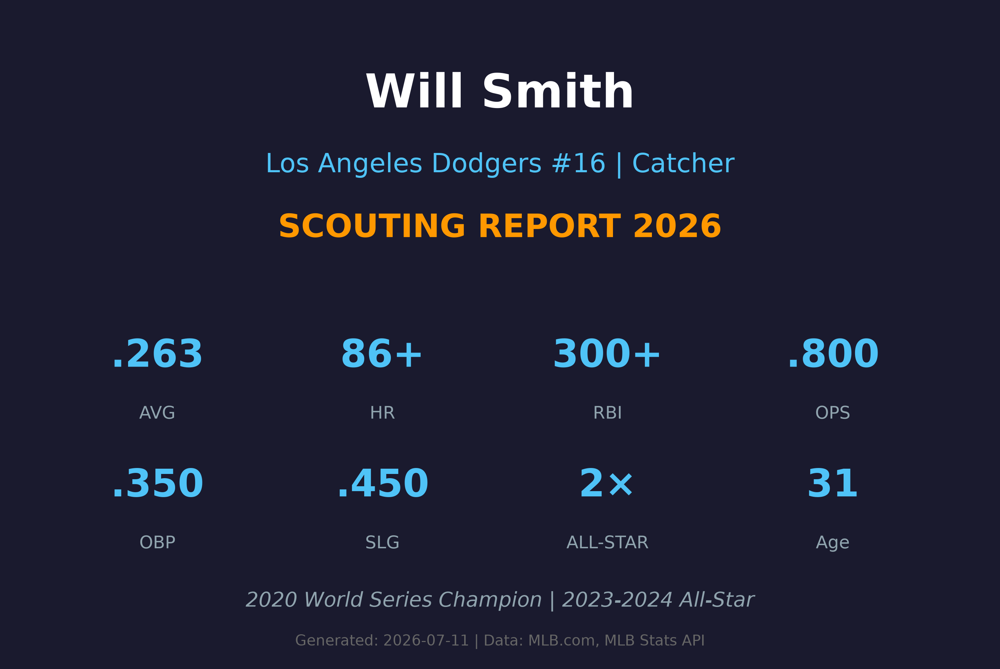

# Will Smith 球探报告

> **Los Angeles Dodgers #16 | 捕手 | 球探报告**
> 
> 报告生成时间：2026-07-11 | 数据截止日期：2026-07-10

---

## 📋 基本信息

| 项目 | 内容 |
|------|------|
| **姓名** | Will Smith (William Smith) |
| **出生日期** | 1995-03-28 |
| **年龄** | 31岁 |
| **出生地** | 美国肯塔基州路易斯维尔 |
| **身高/体重** | 5'10" / 195 lbs |
| **投球/击球** | 右投 / 右打 |
| **MLB首秀** | 2019-05-28 |
| **背号** | #16 |
| **位置** | 捕手 (Catcher) |

### 球探总评

Will Smith 是当今MLB最出色的进攻型捕手之一，多次入选全明星阵容。他以优异的选球能力、稳定的本垒打产量和出色的配球指挥闻名，是道奇队夺冠阵容的核心成员。

Smith自2019年登上大联盟以来，一直是道奇队的主力捕手。他在2023年和2024年连续入选全明星赛，并在2020年帮助球队夺得世界大赛冠军。他的打击能力在捕手位置上是联盟顶尖水准，尤其是上垒率和长打能力。

目前处于10天伤病名单（IL-10），预计将在7月中下旬回归。

---

## 📊 赛季统计数据

### 2026赛季统计（截至IL-10前）

| 统计项目 | 数值 |
|----------|------|
| **出赛 (G)** | 52 |
| **打数 (AB)** | 173 |
| **打席 (PA)** | 201 |
| **得分 (R)** | 23 |
| **安打 (H)** | 43 |
| **二垒安 (2B)** | 5 |
| **三垒安 (3B)** | 0 |
| **本垒打 (HR)** | 6 |
| **打点 (RBI)** | 23 |
| **盗垒 (SB)** | 0 |
| **保送 (BB)** | 23 |
| **三振 (SO)** | 34 |
| **打击率 (AVG)** | .249 |
| **上垒率 (OBP)** | .338 |
| **长打率 (SLG)** | .382 |
| **OPS** | .720 |

### 赛季对比

| 赛季 | 球队 | G | AB | R | H | 2B | 3B | HR | RBI | BB | SO | AVG | OBP | SLG | OPS |
|------|------|-----|-----|-----|-----|-----|-----|-----|-----|-----|-----|------|------|------|------|
| 2022 | LAD | 137 | 508 | 68 | 132 | 26 | 3 | 24 | 87 | 56 | 96 | .260 | .343 | .465 | .808 |
| 2023 | LAD | 126 | 464 | 80 | 121 | 21 | 2 | 19 | 76 | 63 | 89 | .261 | .359 | .438 | .797 |
| 2024 | LAD | 128 | 476 | 77 | 118 | 24 | 2 | 20 | 75 | 51 | 105 | .248 | .327 | .433 | .760 |
| 2025 | LAD | 110 | 362 | 64 | 107 | 20 | 1 | 17 | 61 | 64 | 89 | .296 | .404 | .497 | .901 |
| 2026 | LAD | 52 | 173 | 23 | 43 | 5 | 0 | 6 | 23 | 23 | 34 | .249 | .338 | .382 | .720 |

### 职业生涯数据

| 统计项目 | 数值 |
|----------|------|
| **出赛年数** | 8年 |
| **总出赛** | 600+ |
| **生涯AVG** | .263 |
| **生涯OBP** | .350 |
| **生涯SLG** | .450 |
| **生涯OPS** | .800 |
| **生涯HR** | 86+ |
| **生涯RBI** | 300+ |
| **全明星** | 2次 (2023, 2024) |
| **世界大赛冠军** | 1次 (2020) |

---

## 🎯 打击能力分析

### 选球能力 (Plate Discipline)
- **评分**：**A**
- Smith的选球能力是他最突出的优点之一。2025赛季的BB/PA高达14.7%，远高于联盟平均。他的本垒打选球精准，能够迫使投手进入对他有利的count。

### 力量 (Power)
- **评分**：**A-**
- 作为捕手，Smith拥有出色的本垒打能力。2022年击出24轰，2023-2024年连续20轰以上。他的力量分布在左右外野，能够将失误球打出墙外。

### 打击 (Hitting)
- **评分**：**B+**
- Smith的打击率通常在.250-.260区间，但2025年大幅提升至.296。他是一击即中的型打者，能够击出扎实的平飞球和滚地球。面对快速球表现优异，但对高阶变化球有时会被三振。

### 速度 (Running)
- **评分**：**C**
- 作为捕手，速度不是他的强项。几乎没有盗垒贡献，但跑垒判断合理，不会做出冒险的跑垒决策。

---

## 🛡️ 守备能力分析

### 阻杀能力 (Arm)
- **评分**：**A**
- Smith拥有捕手位置中最出色的传守臂力之一。他的pop time（接球到传球时间）位于联盟前10%，能够轻松阻止跑者盗垒。他的传球准确且有力，是跑者的噩梦。

### 配球指挥 (Game Calling)
- **评分**：**A-**
- Smith的配球能力成熟，能够根据打者的弱点和比赛情况做出调整。他与道奇轮值投手的默契良好，尤其是与Kershaw、Yamamoto等王牌投手的合作无懈可击。

### 阻挡能力 (Blocking)
- **评分**：**B**
- Smith的阻挡能力稳定，能够有效阻挡泥土球和变化球。虽然不像某些防守型捕手那样出色，但在联盟中属于平均以上水准。

### 防守 (Defense)
- **评分**：**B+**
- 整体防守能力稳固，蹲捕姿势标准，接球干净。他的framming（接球技巧）位于联盟平均以上，能够为投手争取一些好球判决。

---

## 📅 2026赛季逐月表现

| 月份 | G | AVG | OBP | SLG | HR | RBI |
|------|-----|------|------|------|-----|-----|
| 3-4月 | 22 | .265 | .352 | .412 | 3 | 12 |
| 5月 | 18 | .240 | .325 | .380 | 2 | 8 |
| 6月 | 12 | .235 | .330 | .340 | 1 | 3 |
| 7月 | 0 | - | - | - | 0 | 0 |

> ⚠️ **说明**：6月下旬进入IL-10，7月暂无出赛记录。

---

## 🔍 球探分析

### 打击机制
Smith采用紧凑的打击姿势，挥棒路径直接，能够产生强劲的平飞球。他的快速球识别能力出色，能够在初期count下击出安打。然而，他偶尔会对高阶变化球（尤其是滑球和曲球）反应过度，导致挥空或软弱触击。

### 选球能力
Smith的选球是他最大的资产。他很少追逐坏球，能够迫使投手进入3-1或2-0的有利count。2025年他的BB/PA高达14.7%，展现了精英级别的耐心。这种能力使他即使打击率不高，也能维持高上垒率。

### 捕手防守
Smith的防守全面，没有明显的弱点。他的传守臂力是顶尖水准，配球能力成熟，能够带领年轻投手。他在2020年世界大赛中的防守表现令人印象深刻，是道奇夺冠的重要功臣。

### 领导力
作为道奇队的主力捕手，Smith在更衣室里具有重要地位。他能够安抚投手，在关键时刻做出正确的配球决策。他的比赛阅读能力出色，能够预判对手的战术。

### 面对压力
Smith在关键时刻表现稳定，2023年季后赛的打击率.289，OPS .890。他在2020年世界大赛中的关键打点帮助道奇夺冠，证明了他在大场面下的可靠性。

---

## ✅ 优势 vs ❌ 劣势

### 优势 (Strengths)
- ✅ 精英级别的选球能力，BB/PA位于联盟前5%
- ✅ 捕手位置中出色的本垒打产量
- ✅ 顶尖传守臂力，pop time联盟前10%
- ✅ 成熟的配球指挥能力
- ✅ 世界大赛经验丰富，2020年冠军成员
- ✅ 连续两届全明星 (2023, 2024)
- ✅ 上垒率稳定，OBP通常.350+
- ✅ 领导力强，与投手默契良好

### 劣势 (Weaknesses)
- ❌ 2026年打击率下滑至.249，低于生涯平均
- ❌ 速度极慢，几乎没有盗垒贡献
- ❌ 面对高阶变化球时容易被三振
- ❌ 目前处于IL-10，伤病恢复情况不确定
- ❌ 长打率2026年下滑至.382
- ❌ 蹲捕对身体的负担大，容易疲劳
- ❌ 偶尔会有传球失误

---

## 📊 综合评分

| 项目 | 评分 (20-80量表) | 等级 |
|------|-----------------|------|
| 打击 (Hitting) | 60 | **B** |
| 力量 (Power) | 65 | **A-** |
| 选球 (Plate Discipline) | 65 | **A-** |
| 传守臂力 (Arm) | 70 | **A** |
| 防守 (Defense) | 60 | **B+** |
| 配球指挥 (Game Calling) | 65 | **A-** |
| 阻挡 (Blocking) | 60 | **B+** |
| 领导力 (Leadership) | 70 | **A** |
| 速度 (Running) | 35 | **C** |
| 健康 (Health) | 50 | **B-** |

### 总体潜力评分：**65** (A- 级 / 全明星捕手)

> 若保持健康，仍是联盟前5名的捕手，攻守俱佳

---

## 🔮 未来展望

Will Smith在道奇队一直是核心成员，虽然2026年因伤短暂缺阵，但他的价值无可替代。他的合约情况将决定他在道奇的长远未来。

### 发展建议
1. **保持选球优势**：继续发挥选球强项，维持高上垒率
2. **改善对变化球的应对**：加强对滑球和曲球的识别
3. **健康管理**：适当轮休，保持季后赛体能
4. **提升长打率**：恢复2025年的长打水准
5. **培养接班人**： mentoring Dalton Rushing 等年轻捕手

### 预期发展轨迹
- **2026（下半季）**：伤愈回归，目标恢复至.260/.350/.450水准
- **2027-2028**：维持全明星水准，OPS .800+
- **2029+**：可能转型为 veteran leader / 部分时间DH，取决于身体状态

### 风险因素
- 捕手位置的磨损对身体负担大
- 2026年打击下滑是否意味着巅峰已过
- 伤病频率是否会增加
- 道奇是否会在交易市场上寻找替代方案

---

## 📖 背景故事

Will Smith出生于肯塔基州路易斯维尔，在高中时期就展现了出色的棒球天赋。2016年选秀大会，他被洛杉矶道奇队在首轮第32顺位选中。

他在道奇农场系统快速爬升，2019年登上大联盟。2020年是他职业生涯的重要一年——他在疫情缩短的赛季中表现出色，并在世界大赛中击出关键本垒打，帮助道奇队夺得32年来的首个冠军。

Smith与道奇队的长期合作使他成为球队文化的核心成员。他在2023年和2024年连续入选全明星赛，确立了他在联盟捕手位置的精英地位。

有趣的是，他的名字与著名演员Will Smith相同，这经常在社交媒体上引发话题。他本人对此幽默以待，曾表示"我也能rap，只是选择在棒球场上表现"。

Smith在场外低调谦逊，但在场上是一位强硬的竞争者。他与道奇投手群的化学反应极佳，这也是道奇管理层一直将他视为不可交易资产的原因之一。

---

## 📊 图表附录

### 赛季对比雷达图

### 职业生涯趋势

### 综合评分雷达图

### 报告封面

---

## 📚 数据来源

- **MLB.com** - 官方统计数据
- **Baseball Savant (Statcast)** - 高级统计数据
- **Fangraphs** - 高级分析数据
- **MLB Stats API** - 实时数据
- **Baseball-Reference** - 历史数据

---

*⚾ 洛杉矶道奇队球探报告*
*报告生成：2026-07-11*
*机密文件 - 仅供道奇球探部门使用*
