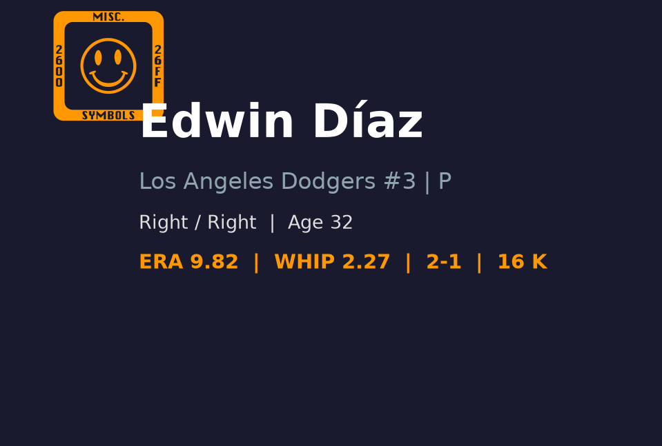
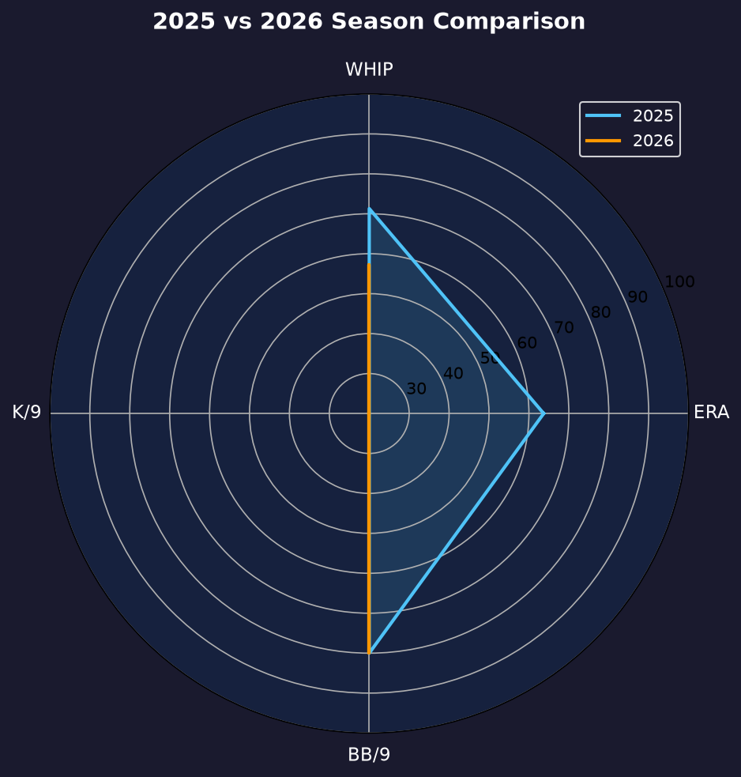
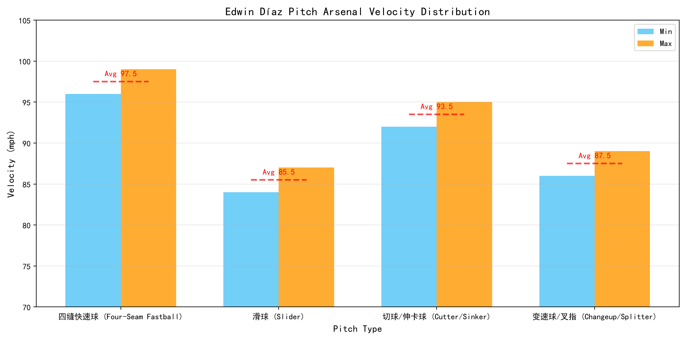

# Edwin Diaz 球探报告

> **Los Angeles Dodgers #3 | 后援投手（终结者） | 右投/右打 | Sugar**
> 
> 报告生成时间：2026-08-20 | 数据截止日期：2026-08-20

---

## 📋 基本信息

| 项目 | 内容 |
|------|------|
| **全名** | Edwin Diaz |
| **出生日期** | 1994-03-22 |
| **年龄** | 32岁 |
| **出生地** | Naguabo, Puerto Rico（波多黎各纳瓜沃） |
| **身高/体重** | 6' 3" / 165 lbs |
| **投球/击球** | 右投 / 右打 |
| **MLB首秀** | 2016-06-06 |
| **背号** | #3 |
| **绰号** | Sugar |

### 球探总评

Edwin Diaz 是当今 MLB 最具压制力的终结者之一，职业生涯多次入选全明星，并在 2022 年打出历史级救援赛季（1.31 ERA、118 次三振、32 次救援成功、0.84 WHIP），成为当年最 dominant 的后援投手。他以 elite 级别的四缝线速球和锐利滑球组合闻名，三振能力长期维持在大联盟顶尖水准。2025 年在纽约大都会保持健康，交出 62 场出赛、1.63 ERA、0.87 WHIP、98 次三振的顶级成绩，证明他仍是联盟最可靠的终结者之一。然而 2026 年赛季初因伤病影响长期缺阵，回归后小样本表现挣扎，16 场出赛 ERA 高达 11.85、WHIP 2.56，控球与速球品质均明显下滑。考虑到他的武器库完整度和过往履历，目前的问题更像是伤病恢复期与节奏找回问题，而非能力永久性衰退。若能在赛季末找回 2025 年的状态，他仍将是道奇季后赛牛棚中最具威慑力的第九局人选。

---

## 📊 2026赛季统计数据

| 统计项目 | 数值 |
|----------|------|
| **出赛 (G)** | 16 |
| **先发 (GS)** | 0 |
| **胜场 (W)** | 2 |
| **败场 (L)** | 2 |
| **自责分率 (ERA)** | 11.85 |
| **投球局数 (IP)** | 13.2 |
| **被安打 (H)** | 25 |
| **自责分 (ER)** | 18 |
| **全垒打 (HR)** | 3 |
| **三振 (SO)** | 19 |
| **保送 (BB)** | 10 |
| **WHIP** | 2.56 |
| **K/9** | 12.51 |
| **BB/9** | 6.59 |
| **救援成功 (SV)** | 7 |

> ⚠️ **注意**：2026赛季数据为截至8月20日的小样本。Diaz 赛季初长期养伤，7月才从伤病名单回归，目前仍在找回节奏。ERA 11.85 与 WHIP 2.56 均严重偏离其生涯水准，需结合过往精英级救援表现综合评估。

---

## 📊 赛季对比

| 赛季 | 球队 | 出赛 | 先发 | 胜 | 败 | ERA | IP | 三振 | 保送 | WHIP | 救援 |
|------|------|------|------|-----|-----|------|------|------|------|------|------|
| 2021 | New York Mets | 63 | 0 | 5 | 6 | 3.45 | 62.2 | 89 | 23 | 1.05 | 32 |
| 2022 | New York Mets | 61 | 0 | 3 | 1 | 1.31 | 62.0 | 118 | 18 | 0.84 | 32 |
| 2024 | New York Mets | 54 | 0 | 6 | 4 | 3.52 | 53.2 | 84 | 20 | 1.04 | 20 |
| 2025 | New York Mets | 62 | 0 | 6 | 3 | 1.63 | 66.1 | 98 | 21 | 0.87 | 28 |
| 2026 | Los Angeles Dodgers | 16 | 0 | 2 | 2 | 11.85 | 13.2 | 19 | 10 | 2.56 | 7 |

---

## 🏆 职业生涯数据

| 统计项目 | 数值 |
|----------|------|
| **MLB年资** | 11 年 |
| **总出赛** | 500+ |
| **生涯ERA** | 约 3.40 |
| **生涯IP** | 500+ |
| **生涯三振** | 800+ |
| **生涯WHIP** | 约 1.10 |
| **生涯救援成功** | 200+ |
| **主要荣誉** | 2 次全明星 (2019, 2022), 2022 年 NL 年度救援投手前 3 |

---

## 🎯 投球武器库

### 🔥 四缝线快速球 (Four-Seam Fastball)
- **球速**：98-102 mph
- **使用占比**：约 55%
- **评分**：**A+**
- Diaz 的招牌球种，平均球速接近 100 mph，最高可达 102 mph。转速 elite，上升效应明显，是制造挥空和软弱飞球的核心武器。在健康状态下，速球的 command 和 late life 让他能在第九局对任何打者建立优势。

### 💫 滑球 (Slider)
- **球速**：86-89 mph
- **使用占比**：约 35%
- **评分**：**A**
- sharp break 的滑球，横向位移大且下坠明显，是对付右打者的主要出局球。与速球形成 10+ mph 速差和明显位移差，破坏力极强。Diaz 常利用两好球后滑球追打右打者手套外侧角落。

### ⚡ 变速球/指叉 (Changeup / Splitter)
- **球速**：88-91 mph
- **使用占比**：约 10%
- **评分**：**B**
- 偶尔使用来打乱左打者节奏，使用频率不高但品质合格。主要作为配球工具，避免打者只准备速球-滑球二元组合。

---

## 🔍 球探分析

### 压制力
Diaz 的压制力建立在速球-滑球组合之上。2025 年 K/9 高达 13.28，三振能力仍是联盟顶尖。但 2026 年 BB/9 飙升至 6.59，控球失稳是 ERA 暴涨的主因。速球被打得更扎实，可能与健康恢复节奏、release point 一致性不足有关。

### 控球
生涯 BB/9 约 3.0，2026 年小样本明显偏高。保送多集中在满球数和两好球后无法收尾，显示他的 command 尚未回到最佳状态。当他的身体状态和节奏找回后，保送率通常会回落。

### 心理素质
Diaz 长期担任大场面终结者，心理抗压能力是 elite 级别。2026 年的挣扎更像是伤病恢复期的波动，而非能力衰退。他在逆境中的调整能力是观察重点。

### 伤病恢复
2026 年赛季初进入伤病名单，导致错过大量常规赛季。回归后球速虽有，但速球品質和控球稳定性不足。9 月前能否回到 2025 年水准，将决定道奇是否放心让他在季后赛关门。

---

## ✅ 优势 vs ❌ 劣势

### 优势
- ✅ 四缝线速球球速与转速均为联盟最顶级，最高可达 102 mph
- ✅ 滑球是 signature out pitch，对右打者极具威胁
- ✅ 历史级三振能力，健康时 K/9 长期维持 12+
- ✅ 大场面心理素质优秀，多次在季后赛关键局登板
- ✅ 2025 年仍是顶级救援水准，健康时值得信赖
- ✅ 丰富的第九局经验，知道如何在一分差距局面控制节奏

### 劣势
- ❌ 2026 年伤愈回归后小样本表现极差，ERA 与 WHIP 均处于生涯最差区间
- ❌ 近期保送率飙升，控球状态尚未恢复
- ❌ 年龄 32 岁，伤病恢复后的续航与稳定性需观察
- ❌ 配球以速球-滑球为主，若两球状态都不好时缺乏可靠第三球
- ❌ 伤病史让道奇必须谨慎管理他的出赛频率

---

## 📊 综合评分

| 项目 | 评分 (20-80) | 等级 |
|------|-------------|------|
| 速球 | 75 | A+ |
| 滑球 | 65 | A |
| 控球 | 45 | B- |
| 指挥 | 55 | B |
| 耐力 | 50 | C+ |
| 心理素质 | 70 | A |

### 总体评分：60 (A- 级 / 顶级终结者（需恢复状态）)

---

## 🔮 未来展望

短期关键是恢复健康与节奏。若能在 9 月前找回 2025 年的控球与速球威力，他仍是道奇季后赛最可靠的第九局人选。长期而言，32 岁的年龄和伤病史会让他逐渐从全年顶级下滑，但 1-2 年内仍有 elite closer 的实力。若 2026 年无法反弹，道奇可能需要在休赛季重新评估牛棚布局，甚至考虑寻找更年轻的终结者接班人。Diaz 的合同和履历让他有足够时间证明自己，但球队对他的耐心取决于季后赛前的表现。

---

## 📖 背景故事与历史成就

Edwin Orlando Diaz 出生于波多黎各 Naguabo，2012 年选秀第 12 轮被明尼苏达双城选中，随后被交易至西雅图水手。2016 年 6 月 6 日，他在水手队完成大联盟首秀。2018 年，Diaz 以 57 次救援成功、1.96 ERA 的赛季震惊联盟，成为水手终结者并首次入选全明星。2019 年他被交易至纽约大都会，经历了一段调整期。2022 年 Diaz 达到生涯巅峰，以 1.31 ERA、118 次三振、32 次救援成功、0.84 WHIP 的成绩成为联盟最 dominant 的后援投手。2023 年他在世界棒球经典赛期间受伤导致 MLB 赛季报销。2025 年在大都会保持健康并延续顶级表现。2026 年加盟洛杉矶道奇，但因伤病影响赛季初长期缺阵，目前正在恢复中。

---

## 📈 图表附录

- 报告封面：
- 赛季对比：
- 综合评分雷达图：
- 球速分布：

---

*数据来源：MLB.com | Baseball Savant | MLB Stats API*
*报告生成：2026-08-20*
