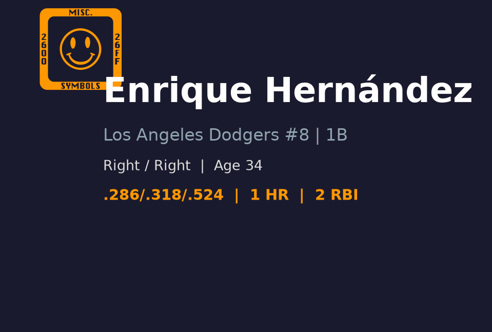
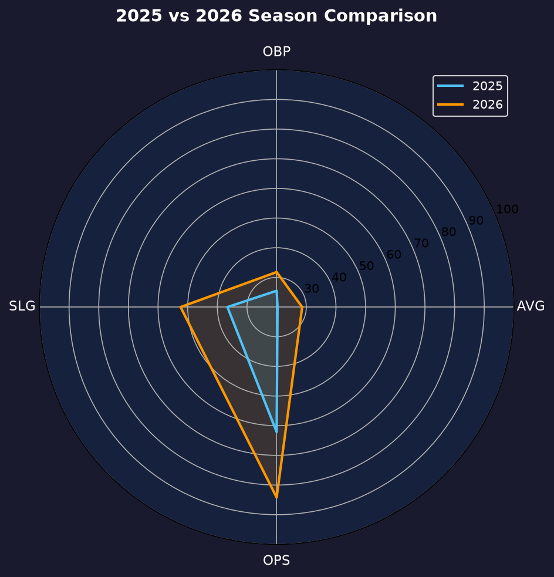
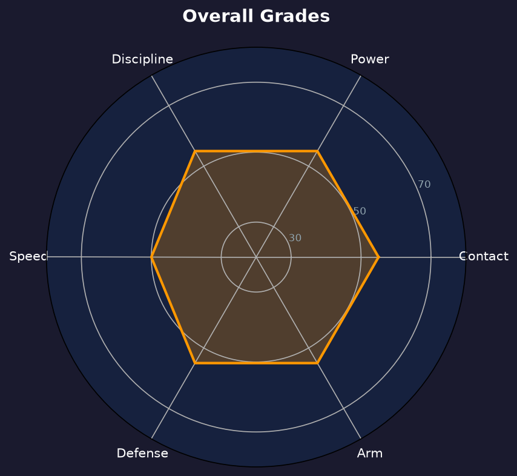

# Enrique Hernandez 球探报告

> **Los Angeles Dodgers #8 | 内野/外野多功能手 | 右打/右投 | Kiké**
> 
> 报告生成时间：2026-08-20 | 数据截止日期：2026-08-20

---

## 📋 基本信息

| 项目 | 内容 |
|------|------|
| **全名** | Enrique Hernandez |
| **出生日期** | 1991-08-24 |
| **年龄** | 34岁 |
| **出生地** | San Juan, Puerto Rico（波多黎各圣胡安） |
| **身高/体重** | 5' 10" / 195 lbs |
| **击球/投球** | 右打 / 右投 |
| **MLB首秀** | 2014-07-01 |
| **背号** | #8 |
| **绰号** | Kiké |

### 球探总评

Enrique 'Kiké' Hernandez 是道奇阵中最具代表性的多功能工具人。他能在二垒、游击、三垒、外野多个位置提供联盟平均以上的防守，打击以拉开比分的全垒打和面对左投见长。2026 年上半季因伤长期缺阵，8 月才回归，目前处于找回节奏阶段。虽然 34 岁的年龄让他的运动能力有所下滑，但他的防守弹性和更衣室价值仍是道奇不可或缺的部分。他的存在让教练团在排兵布阵上拥有极大灵活性，尤其是在季后赛需要应急防守时。

---

## 📊 2026赛季统计数据

| 统计项目 | 数值 |
|----------|------|
| **出赛 (G)** | 16 |
| **打数 (AB)** | 32 |
| **打席 (PA)** | 33 |
| **得分 (R)** | 4 |
| **安打 (H)** | 8 |
| **二垒安 (2B)** | 2 |
| **三垒安 (3B)** | 0 |
| **本垒打 (HR)** | 2 |
| **打点 (RBI)** | 5 |
| **盗垒 (SB)** | 0 |
| **保送 (BB)** | 1 |
| **三振 (SO)** | 9 |
| **打击率 (AVG)** | .250 |
| **上垒率 (OBP)** | .273 |
| **长打率 (SLG)** | .500 |
| **OPS** | .773 |

> ⚠️ **注意**：2026 年 8 月刚从伤病名单（IL-60）激活，目前处于回归调整期，打击样本极小（仅 33 打席），需持续观察。

---

## 📊 赛季对比

| 赛季 | 球队 | G | AB | AVG | OBP | SLG | OPS | HR | RBI | SB |
|------|------|-----|-----|------|------|------|------|-----|-----|-----|
| 2023 | - | 140 | 465 | .237 | .289 | .357 | .646 | 11 | 61 | 4 |
| 2023 | Boston Red Sox | 86 | 297 | .222 | .279 | .320 | .599 | 6 | 31 | 3 |
| 2023 | Los Angeles Dodgers | 54 | 168 | .262 | .308 | .423 | .731 | 5 | 30 | 1 |
| 2024 | Los Angeles Dodgers | 126 | 362 | .229 | .281 | .373 | .654 | 12 | 42 | 0 |
| 2025 | Los Angeles Dodgers | 93 | 232 | .203 | .255 | .366 | .621 | 10 | 35 | 0 |
| 2026 | Los Angeles Dodgers | 16 | 32 | .250 | .273 | .500 | .773 | 2 | 5 | 0 |

---

## 🏆 职业生涯数据

| 统计项目 | 数值 |
|----------|------|
| **MLB年资** | 12 年 |
| **总出赛** | 1,100+ |
| **生涯AVG** | .238 |
| **生涯OBP** | .303 |
| **生涯SLG** | .403 |
| **生涯OPS** | .706 |
| **生涯HR** | 110+ |
| **生涯RBI** | 420+ |
| **生涯SB** | 30+ |
| **主要荣誉** | 2020 年 NLCS 关键全垒打，2023 年世界棒球经典赛波多黎各代表队 |

---

## 🎯 打击能力分析

### 🎯 打击 (Hit)
- **评分**：**B-**
- 生涯 AVG 约 .238，不是高 average 型打者。主要价值在于 timely power 和选球后的长打。回归后小样本 AVG .250，需继续观察。他的挥棒路径适合拉打，容易把内角球扫成深远飞球。

### 💥 力量 (Power)
- **评分**：**B**
- 具备 15-20 轰单季产能，对左投尤其有长打威胁。2026 年回归后 2 轰 / 5 打点，长打率 .500 显示力量仍在。他的 power 分布偏拉打方向，左外野和右外野深区是他主要长打落点。

### ⚡ 速度 (Run)
- **评分**：**C+**
- 34 岁，速度明显下滑，盗垒产出有限，更多担任跑垒机会判断而非纯速度型跑者。他懂得如何利用中等速度做出聪明的跑垒决策。

### 🛡️ 防守 (Defense)
- **评分**：**A-**
- Hernandez 最大的价值所在。能在二垒、游击、三垒、外野多位置提供平均以上防守，range 和传球准确性均不错。虽然不是金手套级别，但稳定可靠。

### 🎯 选球 (Plate Discipline)
- **评分**：**C+**
- BB% 约 3% 在 2026 小样本偏低，生涯选球普通，主要依靠投手失误和特定配球进攻。他懂得在有利 count 出棒，但面对边缘球时耐心不足。

---

## 🛡️ 守备与多功能性

### 守备分析
Hernandez 是联盟知名的 utility player。他每个位置的防守都不算 elite，但全部在平均以上，特别是内野三站和右外野。他的传球准确、脚步灵活，能够在球队出现伤病时无缝顶上任何位置。2026 年回归后，他将主要作为替补守备 / 代打来使用。

### 多功能性
能同时镇守二垒、游击、三垒、外野，让他在道奇 28 人名单中极具战术价值。教练团可以根据对手投手左右手和当场比分灵活调度。他的多功能性是道奇过去几年多次夺冠的重要拼图。

---

## 🔍 球探分析

### 打击分析
Hernandez 不是以打击率为卖点的球员。他的价值在于 occasional power 和打击串联。2026 年回归后 OPS .773 高于生涯平均，但样本仅 33 打席，不能过度解读。

### 角色定位
在道奇目前阵容中，他是 Max Muncy、Mookie Betts、Tommy Edman 等主力内野手的保险，同时也是面对左投时的潜在先发选项。他的存在让主力球员获得轮休机会而不牺牲太多防守。

### 回归观察重点
需要关注他是否能在有限打席中找回击球节奏，以及体能是否能支撑多位置防守。若无法适应大联盟节奏，他可能逐渐被年轻球员取代。

---

## ✅ 优势 vs ❌ 劣势

### 优势
- ✅ 多才多艺，能守 6 个以上位置，阵容弹性极高
- ✅ 对左投有不错长打能力，可作为 platoon 选项
- ✅ 大场面经验丰富，2020 年季后赛表现令人印象深刻
- ✅ 回归后力量输出仍在，2 轰 / .500 SLG 显示身体状况良好
- ✅  clubhouse 领袖气质，团队化学反应正面
- ✅ 防守稳定性高，能在关键时刻顶替伤病球员

### 劣势
- ❌ 34 岁，运动能力和速度持续下滑
- ❌ 对右投表现普通，不适合作为 everyday starter
- ❌ 2026 年上半季重伤缺席，回归后状态不确定
- ❌ 选球普通，容易 chasing 滑球和变化球
- ❌ 防守范围不及专职内野手，只能作为保险

---

## 📊 综合评分

| 项目 | 评分 (20-80) | 等级 |
|------|-------------|------|
| 打击 | 45 | B- |
| 力量 | 55 | B |
| 速度 | 45 | B- |
| 防守 | 65 | A- |
| 臂力 | 55 | B |
| 选球 | 45 | B- |
| 多功能性 | 70 | A |

### 总体评分：55 (B 级 / 优质多功能工具人)

---

## 🔮 未来展望

2026 年剩余赛季，Hernandez 将争取在替补角色中稳定贡献。若身体允许，他可能获得面对左投的先发机会。2027 年他大概率继续以 veteran utility 身份留在联盟，但道奇需要开始培养更年轻的多功能替补。他的职业生涯尾声将以防守弹性和更衣室价值为主。若本季末表现出色，他仍有机会获得一份短期续约。

---

## 📖 背景故事与历史成就

Enrique 'Kiké' Hernandez 出生于波多黎各圣胡安，2014 年 7 月 1 日在休斯顿太空人完成大联盟首秀。2015 年被交易到迈阿密马林鱼，随后加盟洛杉矶道奇。他在 2020 年道奇冠军赛季中多次在季后赛击出关键全垒打，成为球迷喜爱的角色球员。2023 年曾短暂离开道奇加盟波士顿红袜，2024 年回归道奇。2026 年上半季因伤病进入 60 天伤病名单，8 月激活后正在努力恢复状态。他是道奇近年来最受欢迎的 bench player 之一。

---

## 📈 图表附录

- 报告封面：
- 赛季对比：
- 综合评分雷达图：

---

*数据来源：MLB.com | Baseball Savant | MLB Stats API*
*报告生成：2026-08-20*
