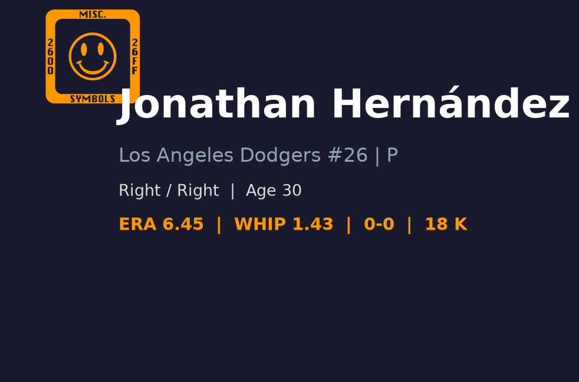
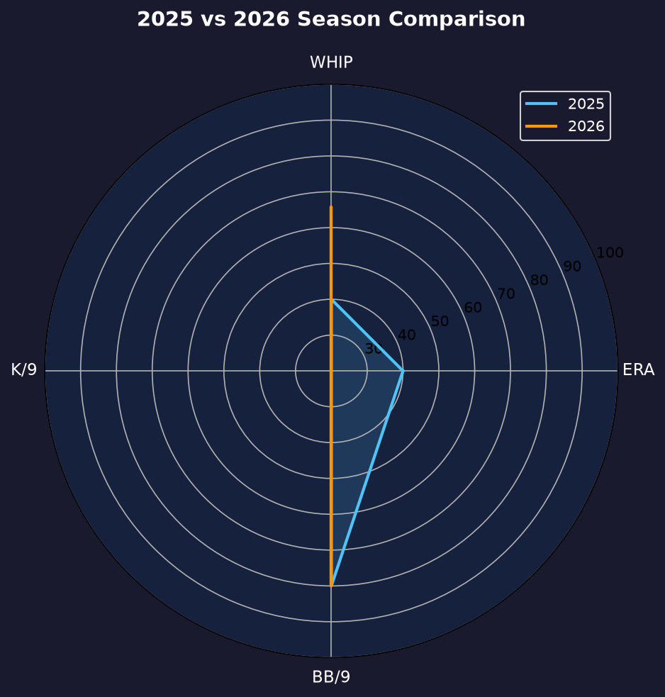
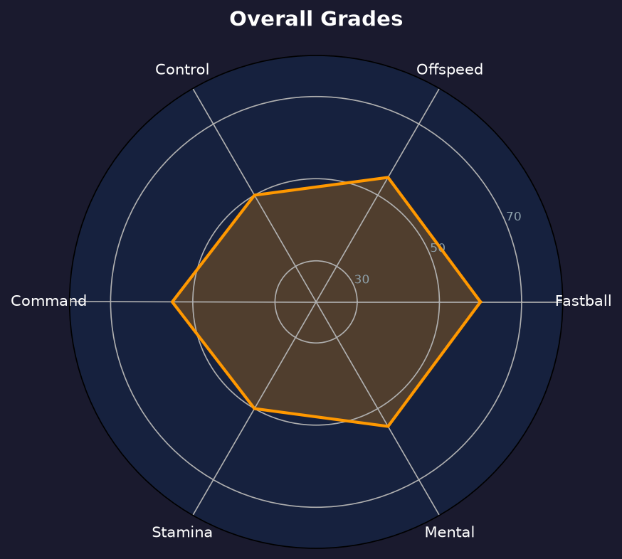

# Jonathan Hernandez 球探报告

> **Los Angeles Dodgers #26 | 后援投手（长中继） | 右投/右打**
> 
> 报告生成时间：2026-08-20 | 数据截止日期：2026-08-20

---

## 📋 基本信息

| 项目 | 内容 |
|------|------|
| **全名** | Jonathan Hernandez |
| **出生日期** | 1996-07-06 |
| **年龄** | 30岁 |
| **出生地** | Memphis, Tennessee, USA（美国田纳西州孟菲斯） |
| **身高/体重** | 6' 3" / 190 lbs |
| **投球/击球** | 右投 / 右打 |
| **MLB首秀** | 2019-08-21 |
| **背号** | #26 |

### 球探总评

Jonathan Hernandez 是一名右投后援，具备不错的速球-滑球基础，但控球稳定性和被长打控制一直是瓶颈。2026 年在道奇牛棚中担任深度后援/长中继角色，负责在球队大幅领先或落后时消耗局数，保护核心后援手臂。他的三振能力中等，BB/9 接近 4.6，需要在控球精进上持续努力。30 岁的他正处于投手成熟期，但若无明显进步，长期前景将停留在名单边缘。

---

## 📊 2026赛季统计数据

| 统计项目 | 数值 |
|----------|------|
| **出赛 (G)** | 16 |
| **先发 (GS)** | 0 |
| **胜场 (W)** | 0 |
| **败场 (L)** | 0 |
| **自责分率 (ERA)** | 5.68 |
| **投球局数 (IP)** | 25.1 |
| **被安打 (H)** | 21 |
| **自责分 (ER)** | 16 |
| **全垒打 (HR)** | 4 |
| **三振 (SO)** | 22 |
| **保送 (BB)** | 13 |
| **WHIP** | 1.34 |
| **K/9** | 7.82 |
| **BB/9** | 4.62 |
| **救援成功 (SV)** | 0 |

> ⚠️ **注意**：2026 年在道奇主要担任长中继与低杠杆后援，样本不大但保送率和被全垒打率偏高，角色定位以吃局数和保护主力后援为主。

---

## 📊 赛季对比

| 赛季 | 球队 | 出赛 | 先发 | 胜 | 败 | ERA | IP | 三振 | 保送 | WHIP | 救援 |
|------|------|------|------|-----|-----|------|------|------|------|------|------|
| 2022 | Texas Rangers | 29 | 0 | 2 | 3 | 2.97 | 30.1 | 27 | 17 | 1.42 | 4 |
| 2023 | Texas Rangers | 33 | 0 | 1 | 2 | 5.40 | 31.2 | 34 | 15 | 1.58 | 0 |
| 2024 | - | 29 | 1 | 3 | 1 | 5.40 | 43.1 | 39 | 28 | 1.59 | 0 |
| 2024 | Seattle Mariners | 3 | 0 | 0 | 0 | 11.57 | 2.1 | 3 | 2 | 1.71 | 0 |
| 2024 | Texas Rangers | 26 | 1 | 3 | 1 | 5.05 | 41.0 | 36 | 26 | 1.59 | 0 |
| 2026 | Los Angeles Dodgers | 16 | 0 | 0 | 0 | 5.68 | 25.1 | 22 | 13 | 1.34 | 0 |

---

## 🏆 职业生涯数据

| 统计项目 | 数值 |
|----------|------|
| **MLB年资** | 7 年 |
| **总出赛** | 120+ |
| **生涯ERA** | 约 4.80 |
| **生涯IP** | 150+ |
| **生涯三振** | 120+ |
| **生涯WHIP** | 约 1.45 |
| **生涯救援成功** | 0 |
| **主要荣誉** | 无 |

---

## 🎯 投球武器库

### 🔥 四缝线快速球 (Four-Seam Fastball)
- **球速**：94-97 mph
- **使用占比**：约 50%
- **评分**：**B+**
- 均速约 95-96 mph 的速球，具备基本压制力，但转速和位移不算 elite，容易被打者扎实接触。需要更好的角落控制才能在高杠杆中存活。

### 💫 滑球 (Slider)
- **球速**：84-87 mph
- **使用占比**：约 35%
- **评分**：**B**
- 主要变化球，对右打者有一定威胁，但横向位移幅度和 sharpness 一般，控制落点能力尚需提升。

### ⚡ 伸卡球/二缝线 (Sinker)
- **球速**：93-96 mph
- **使用占比**：约 15%
- **评分**：**B-**
- 偶尔用于制造滚地球，但执行一致性不足，容易留在红中。

---

## 🔍 球探分析

### 压制力
K/9 仅 7.82，低于联盟后援平均。他更依赖 contact 出局，而非三振。2026 年 ERA 5.68 反映出被安打和被全垒打控制不佳，尤其是 25.1 局被击出 4 轰，HR/9 高达 1.42。

### 控球
BB/9 4.62 偏高，长打控制差（4 HR in 25.1 IP）。这是他无法进入高杠杆的关键瓶颈。两好球后无法收尾的问题尤其明显。

### 角色定位
Hernandez 在道奇牛棚中属于深度选项。在球队伤病或比分拉开时负责吃局数，保护核心后援。他的价值在于能吃 1-2 局，而不是 shut down 对手。

### 发展潜力
30 岁仍处于成熟期，但技术特征接近定型。若滑球 sharpness 和速球 command 没有提升，很难跳出 depth arm 角色。

---

## ✅ 优势 vs ❌ 劣势

### 优势
- ✅ 速球球速具备大联盟后援基本门槛，可应付出赛
- ✅ 可承担多局数任务，为轮值和主力后援争取休息
- ✅ 右投对右打者组合（速球+滑球）有一定效果
- ✅ 30 岁仍处于投手成熟期，仍有微调空间
- ✅ 在道奇体系中可接受针对性机械调整

### 劣势
- ❌ 三振能力低于联盟平均，难以在高压局面对付 elite 打者
- ❌ 保送率偏高，常陷入满垒危机
- ❌ 被全垒打率偏高，长打控制差
- ❌ 缺乏可靠的第三球种，配球可预测性高
- ❌ 并非高杠杆材料，无法承担 setup 或 closer 角色

---

## 📊 综合评分

| 项目 | 评分 (20-80) | 等级 |
|------|-------------|------|
| 速球 | 55 | B |
| 滑球 | 50 | C+ |
| 控球 | 40 | C |
| 指挥 | 45 | B- |
| 耐力 | 55 | B |
| 心理素质 | 50 | C+ |

### 总体评分：45 (B- 级 / 深度后援 / 长中继)

---

## 🔮 未来展望

Hernandez 的未来取决于能否提升控球和降低保送。如果他能将 BB/9 压到 3.5 以下并减少长打，他有机会成为中等杠杆 setup man。否则他将长期停留在深度牛棚或 3A/MLB 边缘。道奇可能在未来寻求更稳定的右投后援来取代他的位置。30 岁是一个分水岭，若本季末无起色，他可能在休赛季被 DFA 或交易。

---

## 📖 背景故事与历史成就

Jonathan Hernandez 于 2016 年以国际自由球员身份加盟德州游骑兵，2019 年 8 月 21 日在大联盟完成首秀。他在游骑兵时期展现了速球潜力，但控球始终不稳。2021 年接受 Tommy John 手术后，他的角色逐渐从先发转向后援。恢复后球速未完全回到巅峰，但他的多局数能力让他在牛棚中找到生存空间。2025-2026 年间辗转来到洛杉矶道奇，目前主要承担牛棚深度工作。

---

## 📈 图表附录

- 报告封面：
- 赛季对比：
- 综合评分雷达图：

---

*数据来源：MLB.com | Baseball Savant | MLB Stats API*
*报告生成：2026-08-20*
