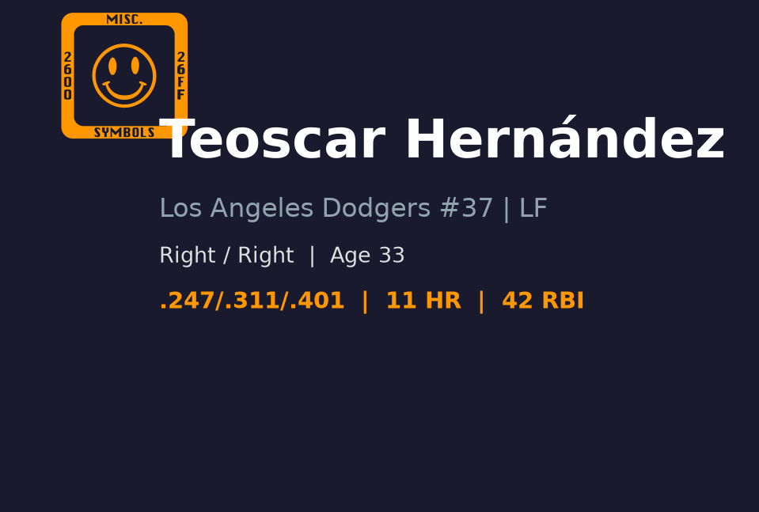
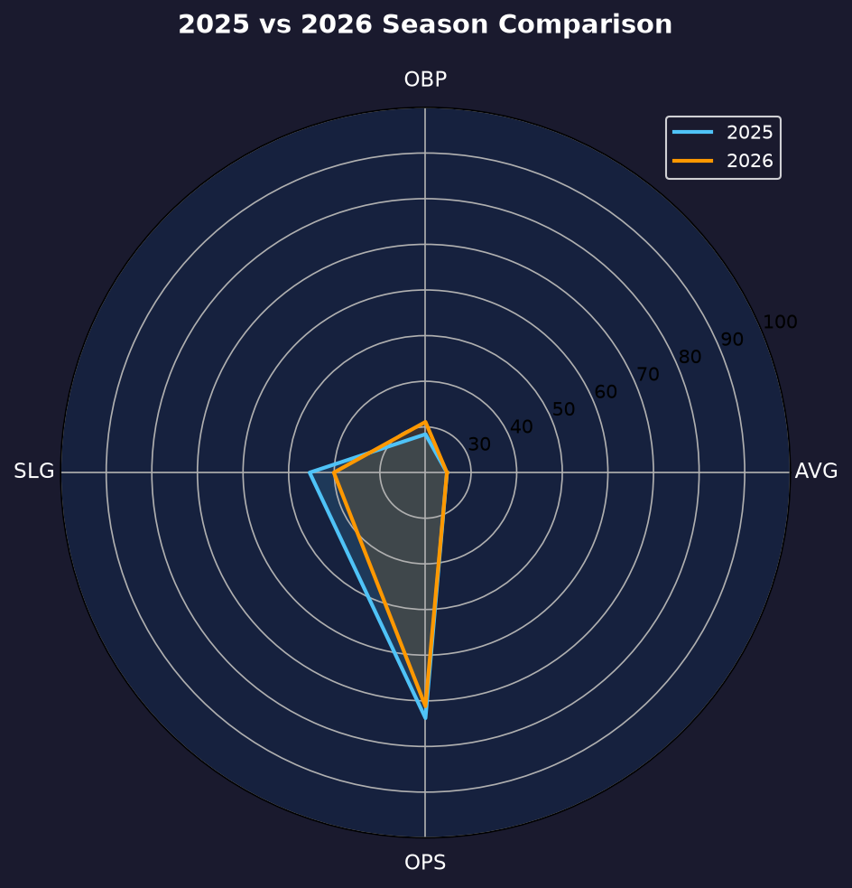
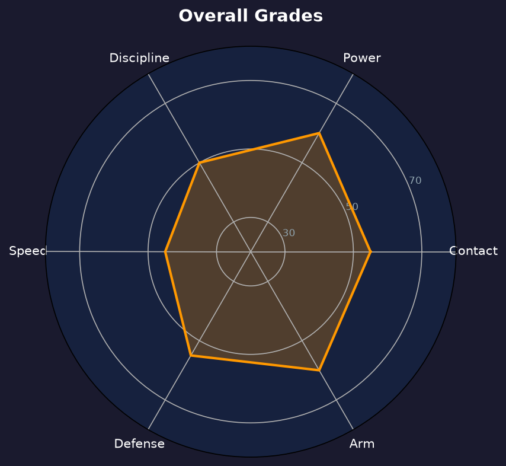

# Teoscar Hernandez 球探报告

> **Los Angeles Dodgers #37 | 左外野手 | 右打/右投**
> 
> 报告生成时间：2026-08-20 | 数据截止日期：2026-08-20

---

## 📋 基本信息

| 项目 | 内容 |
|------|------|
| **全名** | Teoscar Hernandez |
| **出生日期** | 1992-10-15 |
| **年龄** | 33岁 |
| **出生地** | Cotui, Dominican Republic（多米尼加共和国科图伊） |
| **身高/体重** | 6' 0" / 215 lbs |
| **击球/投球** | 右打 / 右投 |
| **MLB首秀** | 2016-08-12 |
| **背号** | #37 |

### 球探总评

Teoscar Hernandez 是一名以力量见长的右打外野手，2026 年加入道奇后担任左外野主力。他具备稳定的中段打线和 25+ 轰级别的长打产能，但三振率偏高、选球普通，整体攻击效率接近联盟平均。他的防守在外野三个位置都能胜任，臂力是其守备亮点。2026 年截至目前 OPS .714，与生涯平均接近，但相较于 2024 年道奇赛季的 .840 OPS 有明显下滑。他需要在赛季末段提升长打效率，才能在季后赛打线中扮演更重要角色。

---

## 📊 2026赛季统计数据

| 统计项目 | 数值 |
|----------|------|
| **出赛 (G)** | 93 |
| **打数 (AB)** | 324 |
| **打席 (PA)** | 358 |
| **得分 (R)** | 50 |
| **安打 (H)** | 81 |
| **二垒安 (2B)** | 14 |
| **三垒安 (3B)** | 1 |
| **本垒打 (HR)** | 11 |
| **打点 (RBI)** | 43 |
| **盗垒 (SB)** | 2 |
| **保送 (BB)** | 29 |
| **三振 (SO)** | 97 |
| **打击率 (AVG)** | .250 |
| **上垒率 (OBP)** | .313 |
| **长打率 (SLG)** | .401 |
| **OPS** | .714 |

> ⚠️ **注意**：2026 赛季为道奇常规左外野手，已出赛 93 场，是主要轮值成员。数据截至 8 月 20 日。

---

## 📊 赛季对比

| 赛季 | 球队 | G | AB | AVG | OBP | SLG | OPS | HR | RBI | SB |
|------|------|-----|-----|------|------|------|------|-----|-----|-----|
| 2021 | Toronto Blue Jays | 143 | 550 | .296 | .346 | .524 | .870 | 32 | 116 | 12 |
| 2022 | Toronto Blue Jays | 131 | 499 | .267 | .316 | .491 | .807 | 25 | 77 | 6 |
| 2023 | Seattle Mariners | 160 | 625 | .258 | .305 | .435 | .740 | 26 | 93 | 7 |
| 2024 | Los Angeles Dodgers | 154 | 589 | .272 | .339 | .501 | .840 | 33 | 99 | 12 |
| 2025 | Los Angeles Dodgers | 134 | 511 | .247 | .284 | .454 | .738 | 25 | 89 | 5 |
| 2026 | Los Angeles Dodgers | 93 | 324 | .250 | .313 | .401 | .714 | 11 | 43 | 2 |

---

## 🏆 职业生涯数据

| 统计项目 | 数值 |
|----------|------|
| **MLB年资** | 10 年 |
| **总出赛** | 950+ |
| **生涯AVG** | .255 |
| **生涯OBP** | .313 |
| **生涯SLG** | .460 |
| **生涯OPS** | .773 |
| **生涯HR** | 180+ |
| **生涯RBI** | 520+ |
| **生涯SB** | 40+ |
| **主要荣誉** | 2 次银棒奖 (2020, 2021), 2 次全明星 (2021, 2022) |

---

## 🎯 打击能力分析

### 🎯 打击 (Hit)
- **评分**：**B-**
- AVG .250、strikeout rate 约 27% 显示他不是高 contact 型打者，但 barrel 能力让他在球打甜时威胁极大。他的挥棒路径较长，容易在快速球和变化球交界处挥空。

### 💥 力量 (Power)
- **评分**：**A-**
- 生涯单季多次击出 25+ 轰，平均 exit velocity 和 hard-hit rate 位于联盟前段。2026 年 11 轰、.401 SLG 略低于巅峰，但仍是道奇主要 power source。他的 raw power 足以把球打到任何方向。

### ⚡ 速度 (Run)
- **评分**：**C+**
- 33 岁，速度已非卖点，2026 年仅 2 盗。跑垒判断尚可，但不适合担任开路先锋。他的速度足以在右外野防守中覆盖中等范围。

### 🛡️ 防守 (Defense)
- **评分**：**B**
- 左外野防守稳定，range 中等，接球手法可靠。臂力优于平均，能阻止跑者推进。他在外野角落位置的防守值得信赖。

### 🎯 选球 (Plate Discipline)
- **评分**：**C+**
- BB% 约 8.1%，三振率偏高。面对变化球和边缘速球容易出棒，是主要被利用弱点。若能提升选球耐心，他的 OBP 和整体攻击效率会明显改善。

---

## 🛡️ 守备与多功能性

### 守备分析
Hernandez 主要镇守左外野，也能客串右外野。他的 first step 和 range 属联盟平均，但接球稳定、臂力突出，能有效阻止跑者从 singles 进垒到二垒。他不会是金手套候选人，但也不会成为防守负担。

### 多功能性
虽然以左外野为主，但在必要时也能担任指定打击或右外野。他的价值更多集中在打击输出而非守备弹性。道奇安排他左外野先发，是因为他在这个位置能最大化打击贡献同时不牺牲太多防守。

---

## 🔍 球探分析

### 打击分析
2026 年 OPS .714 接近生涯平均，但相较于 2020-2022 年的巅峰期（单季 OPS .800+）有所下滑。主要问题是三振率居高不下，且出棒范围大。他的 swing-and-miss 问题在面对 elite 变化球时尤其明显。

### 长打效率
.401 SLG 对于一名以力量为卖点的外野手来说偏低。若想在季后赛扮演更重要角色，他需要提升 barrel rate 和对变化球的识别。2024 年在道奇打出的 .501 SLG 证明他仍有能力，但 2025-2026 年呈现下滑趋势。

### 角色定位
在道奇打线中，Hernandez 主要担任第 5-7 棒，负责提供长打保护和 RBI 产出。他不是建队核心，但是阵容深度的关键拼图。面对左投时他的价值更高。

---

## ✅ 优势 vs ❌ 劣势

### 优势
- ✅ 稳定的中段 power 产出，具备 25+ 轰产能
- ✅ hard-hit 能力强，击球初速联盟前列
- ✅ 外野防守稳定，臂力优于平均
- ✅  postseason 经验丰富，多次帮助球队进入季后赛
- ✅ 右打平衡道奇左打偏重的打线
- ✅ 在道奇体系的击球教练帮助下仍有提升空间

### 劣势
- ❌ 三振率偏高，容易在关键时刻被三振出局
- ❌ 选球普通，BB% 不高，上垒能力有限
- ❌ 2026 年 SLG .401 低于生涯平均，力量输出有下滑迹象
- ❌ 33 岁，运动能力进入衰退期
- ❌ 对 elite 变化球和高速内角球应对不佳

---

## 📊 综合评分

| 项目 | 评分 (20-80) | 等级 |
|------|-------------|------|
| 打击 | 45 | B- |
| 力量 | 65 | A- |
| 速度 | 45 | B- |
| 防守 | 50 | C+ |
| 臂力 | 55 | B |
| 选球 | 45 | B- |

### 总体评分：55 (B 级 / 联盟平均以上 power 型外野手)

---

## 🔮 未来展望

2026 年赛季剩余部分，Hernandez 需要提升长打率和减少三振，以维持道奇外野主力的位置。2027 年他仍有望获得一份合约，但随着年龄增长，他可能逐渐转为 platoon 外野手或指定打击。长期来看，他的 best-case 是成为一名 veteran power bat，worst-case 则是因三振率过高而失去先发位置。道奇可能会在休赛季评估是否引进更年轻、contact 能力更好的外野手。

---

## 📖 背景故事与历史成就

Teoscar Hernandez 出生于多米尼加共和国科图伊，2011 年以国际自由球员身份加盟休斯顿太空人，2016 年 8 月 12 日完成大联盟首秀。他在太空人时期机会有限，2017 年被交易至多伦多蓝鸟后逐渐成长为全明星外野手。2020-2021 年连续获得美联外野手银棒奖，2021-2022 年连续两年入选全明星。2023 年转投西雅图水手，2024-2025 年持续贡献稳定 power 输出。2026 年加入洛杉矶道奇，希望在这座冠军球队中扮演重要角色。

---

## 📈 图表附录

- 报告封面：
- 赛季对比：
- 综合评分雷达图：

---

*数据来源：MLB.com | Baseball Savant | MLB Stats API*
*报告生成：2026-08-20*
