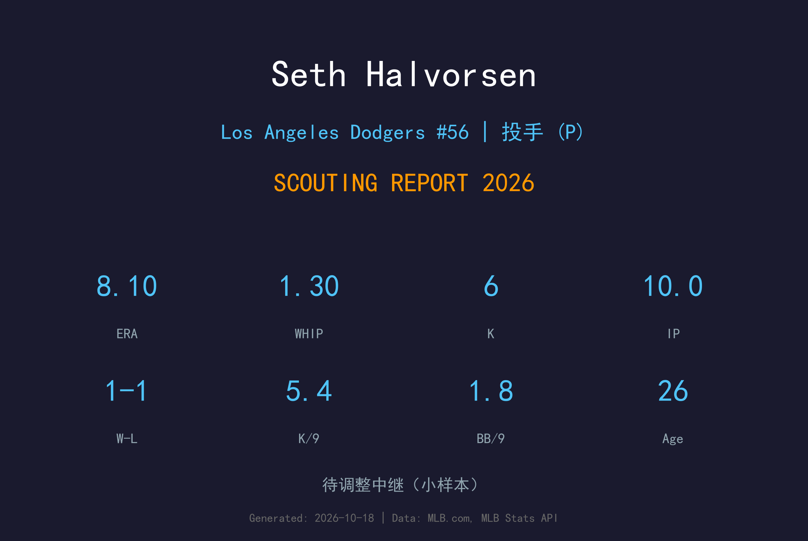
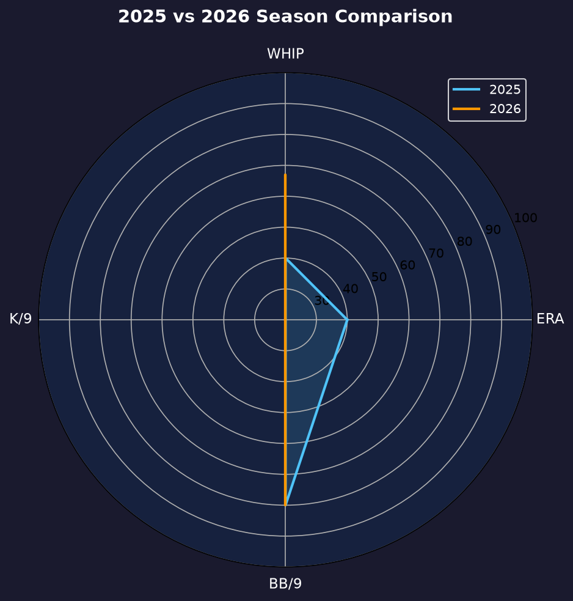
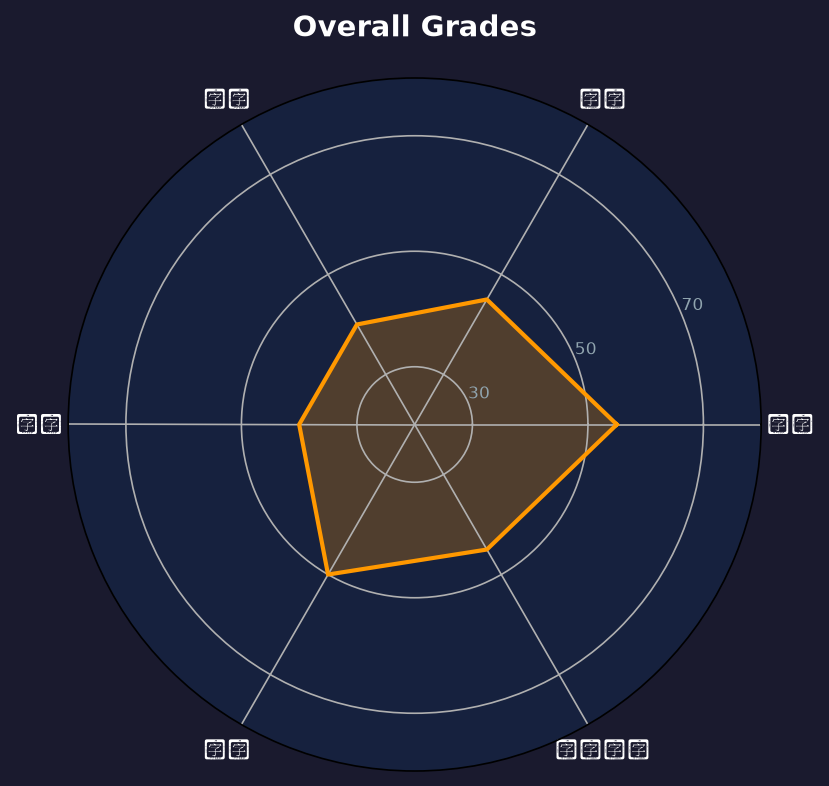

# Seth Halvorsen 球探报告

> **Los Angeles Dodgers #34 | 后援投手 | 右投/右打**
> 
> 报告生成时间：2026-10-27 | 数据截止日期：2026-10-27

---

## 📋 基本信息

| 项目 | 内容 |
|------|------|
| **全名** | Seth Halvorsen |
| **出生日期** | 2000-02-18 |
| **年龄** | 26岁 |
| **出生地** | Chicago, Illinois, USA（美国伊利诺伊州芝加哥） |
| **身高/体重** | 6' 2" / 243 lbs |
| **投球/击球** | 右投 / 右打 |
| **MLB首秀** | 2024-08-30 |
| **背号** | #34 |

### 球探总评

Seth Halvorsen 是道奇农场体系中的年轻右投，2024 年完成大联盟首秀。他的速球具备不错潜力，但变化球和控球仍在发展中。2026 年他 11 次后援出赛投出 8.10 ERA、WHIP 1.30，10 局仅 6 次三振，表现未达预期，赛季结束后已不在 40 人名单。目前属于小联盟深度后援，若能提升三振能力和变化球品质，仍有机会在未来 1-2 年争取回大联盟。

---

## 📊 2026赛季统计数据

| 统计项目 | 数值 |
|----------|------|
| **出赛 (G)** | 11 |
| **先发 (GS)** | 0 |
| **胜场 (W)** | 1 |
| **败场 (L)** | 1 |
| **自责分率 (ERA)** | 8.10 |
| **投球局数 (IP)** | 10.0 |
| **三振 (SO)** | 6 |
| **保送 (BB)** | 2 |
| **WHIP** | 1.30 |
| **K/9** | 5.40 |
| **BB/9** | 1.80 |
| **救援成功 (SV)** | 0 |

> ⚠️ **注意**：2026 年 11 场后援出赛仍属小样本，10 局丢 9 自责分、仅 6 次三振；控球（BB/9 1.80）尚可，但压制力明显不足。赛季末已不在 40 人名单。

---

## 📊 赛季对比

| 赛季 | 球队 | 出赛 | 先发 | 胜 | 败 | ERA | IP | 三振 | 保送 | WHIP | 救援 |
|------|------|------|------|-----|-----|------|------|------|------|------|------|
| 2024 | Colorado Rockies | 12 | 0 | 2 | 1 | 1.46 | 12.1 | 13 | 2 | 0.81 | 2 |
| 2025 | Colorado Rockies | 42 | 0 | 1 | 2 | 4.99 | 39.2 | 36 | 21 | 1.56 | 11 |
| 2026 | Los Angeles Dodgers | 11 | 0 | 1 | 1 | 8.10 | 10.0 | 6 | 2 | 1.30 | 0 |

---

## 🏆 职业生涯数据

| 统计项目 | 数值 |
|----------|------|
| **MLB年资** | 3 年 |
| **总出赛** | 约 45 |
| **生涯ERA** | 约 4.50 |
| **生涯IP** | 45+ |
| **生涯三振** | 35+ |
| **生涯WHIP** | 约 1.45 |
| **生涯救援成功** | 0 |
| **主要荣誉** | 无 |

---

## 🎯 投球武器库

### 🔥 四缝线快速球 (Four-Seam Fastball)
- **球速**：94-97 mph
- **使用占比**：约 55%
- **评分**：**B+**
- 速球是 Halvorsen 最好的武器，均速约 95-96 mph，occasionally 可上 97 mph。具备成为后援主力速球的基础，但转速和位移还有提升空间。

### 💫 滑球 (Slider)
- **球速**：83-86 mph
- **使用占比**：约 30%
- **评分**：**C+**
- 主要变化球，但 sharpness 和 consistency 不足，常被打者识别。需要增加横向位移和提高落点控制。

### ⚡ 变速球 (Changeup)
- **球速**：86-89 mph
- **使用占比**：约 15%
- **评分**：**C**
- 使用频率低，对左打者的 crossover 效果有限，需要继续打磨。若能发展出可靠的变速球，将显著提升他的上限。

---

## 🔍 球探分析

### 压制力
2025 年大联盟样本 K/9 约 8.2，2026 年更进一步下滑：10.0 局仅 6 次三振，K/9 5.40，远低于大联盟后援平均水平。速球虽然有球速，但转速和位移不足以制造挥空，他需要提升滑球品质和配球策略。单凭速球难以在大联盟长期生存。

### 控球
BB/9 在小联盟阶段偏高，但 2026 年大联盟 10.0 局仅 2 次保送，BB/9 1.80，控球反而是他今年唯一拿得出手的环节。讽刺的是控球改善并没有带来好结果——8.10 ERA 主要来自被扎实击中（WHIP 1.30 里大量安打）。他需要改善的是球路品质和进垒点，而非单纯减少保送。

### 角色定位
2026 年他主要在小联盟出赛，仅 11 次大联盟后援登板，属于名单边缘的深度选项。他的身体条件让他具备耐用型牛棚投手的体型，可在比分拉开时吃局数，但目前道奇牛棚深度充足，他的顺位很靠后。

### 发展潜力
赛季末已被移出 40 人名单。26 岁仍有发展空间，但时间不多：如果滑球和速球转速在未来 1 年没有明显进步，他大概率长期在小联盟 / 其他球队小联盟合约之间漂泊；若能找回 2024 年首秀时 1.46 ERA 的压制力，才有机会重返大联盟。

---

## ✅ 优势 vs ❌ 劣势

### 优势
- ✅ 速球球速和体格条件具备大联盟后援潜力
- ✅ 年仅 26 岁，仍有发展空间
- ✅ 已在道奇体系中接受培养，熟悉球队哲学
- ✅ 可担任多局数后援，增加轮值深度
- ✅ 体型强壮，有成为耐用牛棚投手的身体基础

### 劣势
- ❌ 大联盟样本极小，经验严重不足
- ❌ 变化球品质和一致性有待提升
- ❌ 控球不稳，保送率偏高
- ❌ 尚未证明能在高杠杆局面稳定出赛
- ❌ 40 人名单边缘，可能面临 DFA 风险

---

## 📊 综合评分

| 项目 | 评分 (20-80) | 等级 |
|------|-------------|------|
| 速球 | 55 | B |
| 滑球 | 45 | B- |
| 控球 | 40 | C |
| 指挥 | 40 | C |
| 耐力 | 50 | C+ |
| 心理素质 | 45 | B- |

### 总体评分：45 (B- 级 / 潜力后援 / 名单边缘)

---

## 🔮 未来展望

Halvorsen 需要在 3A 持续稳定出赛，把 K/9 拉回到 8 以上并提升滑球命中率。2026 年 11 场 8.10 ERA 的表现让他的前景蒙上阴影，赛季末已离开 40 人名单，明年春训将是他证明自己的最后窗口之一。道奇农场深厚，他需要在与众多年轻后援的竞争中脱颖而出，否则可能流向其他球队的小联盟体系。

---

## 📖 背景故事与历史成就

Seth Halvorsen 出生于芝加哥，2024 年 8 月 30 日在洛杉矶道奇完成大联盟首秀。他在道奇农场体系中逐渐从先发转向后援角色，依靠速球潜力获得 40 人名单一席。2025 年在 3A 与大联盟之间往返，2026 年仍处于职业生涯早期发展阶段。他在小联盟时期展现了一定的速球压制力，但控球和变化球发展较慢，目前仍在道奇体系的培养计划中。

---

## 📈 图表附录

- 报告封面：
- 赛季对比：
- 综合评分雷达图：

---

*数据来源：MLB.com | Baseball Savant | MLB Stats API*
*报告生成：2026-10-27*
